# Cardputer Roast

**English** | [中文](README_zh.md)

Cardputer Roast turns an **M5Stack Cardputer ADV** into a pocket controller for the **E-Roast / E-Meter621 BLE**
fluid-bed coffee roaster (the machine normally driven by the *myERoast* phone app). It talks to the roaster over
Bluetooth LE, follows a roast curve with its own PID, and walks you through a roast on the 240×135
screen: charge, drying, first crack, development, drop, cooling, and a summary that is saved to the SD card and
opens in Artisan. It runs as a native application managed by ESP Hub.

<p>
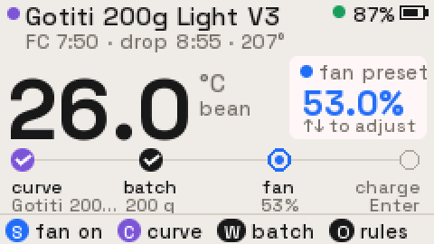
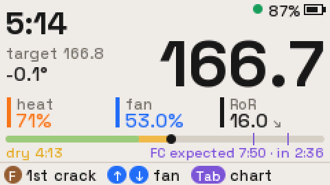
</p>

> **Safety.** This firmware switches a heater on and off. It is not affiliated with or endorsed by the roaster's
> maker, and it was written from observed behaviour, not from vendor documentation. Never leave a roast
> unattended, and keep the machine's own controls within reach.

## Features
- **Curve following.** A PID on the Cardputer follows a curve set by two points, first crack and drop (built-in
  samples, your own curves, or Artisan/myERoast `.alog` files). Every roast follows a curve.
- **Development by plan.** The curve's first crack → drop sets the development: how long, how fast (rate of rise)
  and how hot at most. After F, Roast rises at that rate from where the beans actually cracked and drops when the
  time is over or the temperature is reached. Y (yellowing) and G (first crack end) are marks for the log.
- **Alerts and safety nets.** Colour bars for the coming drop, heater pinned, low RoR
  and BLE loss. Roast makes no sound: alerts are on screen only. Besides the development, Roast drops by
  itself at the safety temperature or long after the curve has ended.
- **Fan control with floors.** Fan ±1 % or ±0.1 %; going below 50 % and 40 % needs a deliberate long press.
- **Curve editor.** Start temperature, first crack and drop (time and temperature), edited on the device with the
  calculated development below, saved to the SD card.
- **Logs.** Every roast is written as `.csv` (1 Hz), `.json` summary and `.alog` for Artisan.
- **ESP Hub networking and Dropbox pairing.** ESP Hub configures Wi-Fi. The Dropbox-only Bluetooth helper authorizes your own Dropbox app (App folder access).
- **Dropbox sync.** Curves live in Dropbox: synced at every boot, and every curve saved or deleted on the device is
  written to Dropbox at once. Each roast's logs are saved to Dropbox from its summary once the fan is off.
- **Simulator.** A built-in thermal model for practising and testing without a machine; a yellow SIM tag shows when
  it is on.
- **Colour-keyed UI.** Colour = what it controls: fan blue, heat orange, curve/PID violet, marks yellow/brown, drop
  and alarms red, "go" green. The bottom row always shows the keys that work right now.

## Screenshots
Rendered from the firmware's own drawing code by the desktop preview (`tools/preview`), 2× scale.

| | |
|---|---|
| 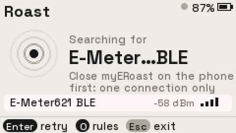 Connect: scans for `E-Meter…BLE` |  Prep: curve → batch → fan → charge |
| 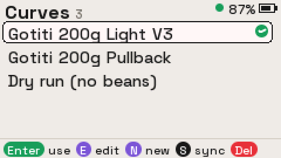 Curve library | 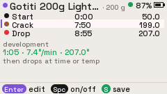 Curve editor: targets and development |
|  Roasting: Maillard, first crack expected | 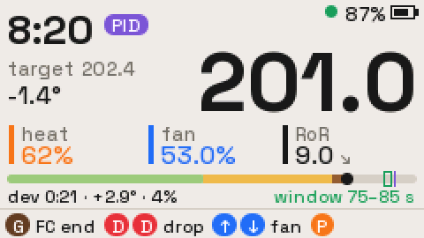 After first crack: development window on the phase bar |
| 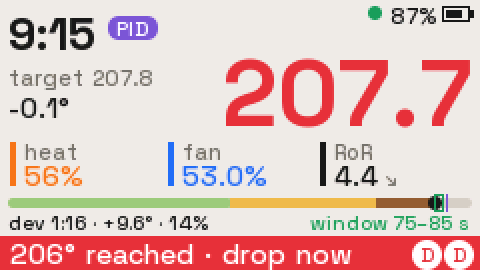 Drop-now temperature reached | 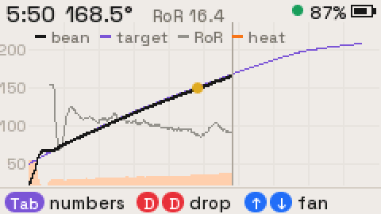 Chart: bean, target, RoR, heater |
| 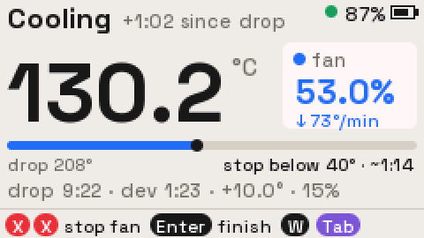 Cooling: progress to the cold temperature | 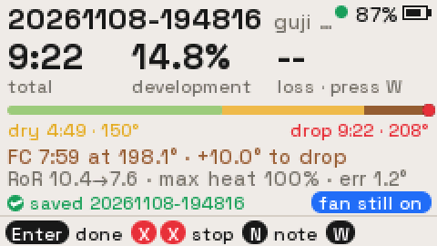 Summary, saved to SD |
| 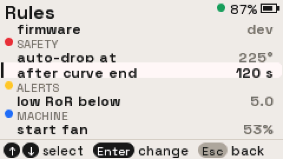 Rules and alerts | 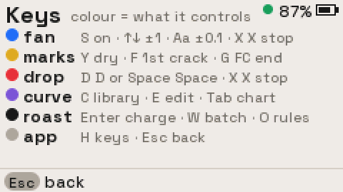 Key map, grouped by colour |

## Install and update with ESP Hub

This project builds a native ESP-IDF application for an ESP Hub-provisioned Cardputer ADV. Register and provision the board through ESP Hub once; existing Hub devices keep their identity and saved networks.

CI publishes the native application binary with its SHA-256. SDK 4.1.0 reports Roast as a native app. On this EspHub release, install the verified binary over USB into the Cardputer-Adv app partition at 0x2a0000.

Keep both ESP Hub launchers, the partition table, and NVS. The app slot starts at `0x2a0000` and holds 4 MiB. Do not run the old community Launcher installer or generic `idf.py flash`. The application no longer checks GitHub for updates, downloads `Roast.bin`, or maintains `latest.json`; updates are initiated through ESP Hub after a roast has ended and the fan is off.

Insert a FAT32 SD card for curves and logs.

## Using it
Turn the *myERoast* app off first: the roaster accepts only one BLE connection at a time.

Roast scans for a device named `E-Meter…BLE` and connects on its own. To try it without a machine, press **D** on
the connect screen, or switch *simulator* on in Rules (**O**). The simulator can only be switched while the
machine is not running.

**H** shows the key map on every page, grouped by colour. The top-right corner shows the battery, the link (green
dot, or the SIM tag).


The battery indicator displays the percentage returned by M5Unified, as in the official Cardputer ADV demo. A reading of 0% is displayed as 0%. On USB, the Cardputer ADV power switch must be ON for charging.

### Prep
The page walks through four steps: curve → batch → fan → charge.

| Key | Action |
|---|---|
| C | Curve library: Enter uses, E edits, N starts a new curve. |
| E | Edit the selected curve (or start a new one). |
| W / B | Batch sheet: green weight and bean name in one place (Tab switches field). |
| O | Rules, alerts and simulator. |
| S | Fan on, no heat. Use it to find a fan setting with cold air before adding beans. |
| ↑ ↓ (`;` `.`) | Fan ±1 % (Aa held: ±0.1 %). While idle this changes only the start-fan preset. |
| Enter | Charge: starts the timer and the Cardputer PID along the curve. Needs the fan on and a curve. |
| X X | Stop the fan. |
| Esc Esc | Back to Launcher. Blocked while the fan is running. |

### Roasting
| Key | Action |
|---|---|
| Y / F / G | Mark drying end / first crack / end of first crack. Press the same key twice more to clear the mark. |
| D D or Space Space | Drop. After the first press the bottom row asks for the second. |
| ↑ ↓ | Fan ±1 % (Aa: ±0.1 %). |
| Tab | Numbers / chart (bean black, target violet, RoR grey, heater orange area). |

The phase bar runs through the whole roast: drying (sage) → Maillard (yellow, starts at Y) → development (brown,
starts at F). After first crack it outlines the development (its time; the bar under it shows time, rise and rate). Exit is locked until the drop.

### Cooling and summary
- Cooling shows the fan, the cooling rate and how far the beans are from the cold temperature.
- **X X** stops the fan and opens the summary. **Enter** finishes the log and leaves the fan running; the summary
  then says "fan still on" and **X X** still stops it there (and on Prep afterwards).
- **W** sets the roasted weight; **N** adds a note; **Enter** goes back to Prep.
- The log ends with Enter or X X on the cooling page, 4 minutes after the drop, or on exit.

The summary shows total time, development percentage and weight loss, the whole roast on the phase bar, first crack
and the rise to drop, RoR at first crack and 30 s later, peak heater output and curve-following error.

### External screen (Cap TFT V2)
With Prokuon's [Cap TFT V2](https://github.com/Prokuon/CardputerADV_Cap_TFT_V2) (a 2.8" ILI9341, 320×240) the
chart has its own screen:

- **Roasting and cooling:** the live chart (bean, target, RoR up to the drop, heater area, marks) under four equal
  cells: time, bean temperature, RoR, and the next milestone. Before F that is when first crack is expected (the
  curve's first-crack temperature, reached with BT's current lead or lag on the curve); after F the development left
  (its time, or sooner the drop temperature at the current RoR); while cooling the time since the drop.
- **Summary:** the whole roast under four cells: total time, development (time and %), drop temperature, weight
  loss.
- **Connect and Prep:** the selected roast plan.

Wiring (as in the Cap TFT V2): SCK 40 and MOSI 14 (shared with the SD card, SPI2), CS 5, DC 6, RST 3; the backlight
is tied to 3.3 V. The screen takes the bus lock for each write, so the SD card keeps working. There is no frame buffer
for it (the Cardputer has no PSRAM): each frame is drawn in 320×16 strips, one per loop pass, at most once a second
and only when something changed. While Wi-Fi and TLS run (sync, saving a roast) the screen keeps its last frame.
Without the cap attached nothing changes.

### ESP Hub networking and Dropbox Bluetooth authorization

For EspHub BLE Wi-Fi provisioning, start the beacon on your computer. With the fan off, open **O → Enter Bootloader** and press **Enter** twice to reboot into the provisioning window.


ESP Hub owns Wi-Fi credentials, connection/reconnection, and SNTP. The application no longer reads/writes `rn_wifi` or exposes a BLE Wi-Fi provisioning characteristic. Configure Wi-Fi through ESP Hub.

Open **O → Dropbox** with the fan off. The roaster link closes because the two roles share NimBLE. The screen shows the passkey and read-only Hub network status. Closing setup stops Dropbox Bluetooth, not the Hub Wi-Fi connection.

The authenticated/encrypted Dropbox GATT protocol is retained: service `c9a81001-9a9d-4f55-a621-5b4e7699b647`, config characteristic `...1005...` (v2 authorize/forget/check packets), status `...1006...`, and notifications `...1004...`. The old Wi-Fi-write characteristic `...1002...` is removed; use the bundled `tools/dropbox-setup.html` helper rather than requiring that characteristic. Open [the Dropbox setup page](https://e7h4n.github.io/cardputer-roast/) in Chrome on a Bluetooth-capable computer. CI publishes it with GitHub Pages. App key, secret, and refresh token remain in `rn_dropbox`, never returned to the client or logged.

### Dropbox sync
Wi-Fi and Dropbox are required: until both are set up, Roast opens the setup screen at boot. Everything below lives in
the Dropbox app's folder (Dropbox › Apps › *app name*). Every transfer is checked against Dropbox's `content_hash`;
nothing is retried: a failure stops with its reason on screen.

| When | What | Direction |
|---|---|---|
| Every boot, and **S** in the curve library | `Roast Curves/` → `roast/curves/`: the card ends up exactly like the folder at that moment (missing or different files downloaded, others deleted). Must succeed: on failure Roast stays on that screen (**Enter** tries again, **O** network setup, **Esc** exit). | Dropbox → card |
| A curve saved in the editor (**S**) | That one file, overwritten on Dropbox. | card → Dropbox |
| A curve deleted in the library (**Del** twice) | That one file, deleted on Dropbox, then on the card. | card → Dropbox |
| On the summary, once the fan is off | `roast/logs/<id>.csv/.json/.alog` → `Roast Logs/`, overwritten, in the background: the summary stays usable (weight, note, chart). An edit there re-saves the .json and .alog. The summary can be closed only when everything is saved (or the save failed). Afterwards the record is not synced again; Roast has no history view. | card → Dropbox |

Last writer wins: the device pushes its own edits immediately, and the next sync replaces the card's curves with
Dropbox's. The Cardputer has no PSRAM, and BLE, Wi-Fi and TLS do not fit together, so each of these closes the roaster
link while it runs and Roast restarts afterwards (a few seconds; the boot after a sync or a push skips the curve
sync). That is why saving or deleting a curve and saving a roast need the fan off (**X X** first). A roast's save takes
a few seconds. While anything syncs, the status corner says
**Syncing** in place of the battery; the sync screen shows details only when it failed.

### Curves and development
A curve is two points, **first crack** and **drop** (time and temperature), plus the charge temperature (default
50 °C). Yellowing is not a curve point: Y marks it during the roast, for the log. Older files keep working: their
`FCs` and `DROP` points are used, everything else (`DRY`, `FCe`, `SCs`, `SCe`, untagged points, `total_s`) is
ignored.

The two points set the **development**, the part that matters most:

| | from the curve | e.g. Syrina D 100g |
|---|---|---|
| how long | drop time − first-crack time | 45 s |
| how fast | (drop − first-crack temperature) ÷ that time | 11.2 °C/min |
| how hot at most | drop temperature | 208.5 °C |

**When F is pressed**, the target rises at that rate from the beans' temperature at F, and **Roast drops when the
time is over or BT reaches the drop temperature**, whichever comes first. This is not a setting. A crack later or
hotter than planned therefore drops early on temperature (in the simulation below, 20–26 s after F instead of
45 s); one cooler than planned runs the full time and ends below the drop temperature. Without F, Roast drops at
the drop temperature or at the curve's drop time. Pressing F twice clears it and goes back to the curve. A bar says "auto-drop" in the last 10 s or 1 °C.

`roast_curve.cpp` builds the 1 Hz target:

- **Charge → first crack:** the vendor's dark-roast preset, a smooth curve with the rate of rise falling from ~27 to
  ~10 °C/min, stretched in time and temperature so it starts at the charge temperature and passes through first
  crack. Before first crack its rate of rise blends smoothly into the development rate (over a minute, longer for a
  bigger change), so there is no corner at first crack. The editor warns if the rate would have to go *up* into the
  crack.
- **First crack → drop:** a straight line at the development rate.

No corners anywhere: the myERoast-style builder added straight-line corrections at every mark, which put a
rate-of-rise step at each one (−4.5 °C/min at first crack on Syrina D 100g). On batches A and B that step, with BT
2–3 °C behind the line, carried BT over the target and the roaster's PID cut the heater by ~5 %: the rate of rise
fell from ~18 to ~0 (R0012, R0013).

On Syrina D 100g as planned for the competition (first crack 7:05 / 200.1, 45 s at 11.2 °C/min, at most
208.5 °C), in `tools/pid` (`fc_crack`), against the previous firmware (the cornered curve, drop by hand at F + 45 s):

| Crack | previous | this |
|---|---|---|
| on time | 45 s, +6.6 to 207.1, RoR down to 8.4 | 43 s, +8.0, at **208.5**, RoR 11.1 |
| 15 s early | 45 s, +8.4 to 204.9 | 45 s, +8.4 to 204.9 |
| 15 s late | 35–37 s, to 208.5–209.4 | 20–26 s, at **208.5**, RoR at the planned 11.1–11.5 |

In all nine cases (crack with no heat effect, absorbing, or releasing heat) the rate of rise follows the plan as
well or better (mean |RoR − plan| 0.00–0.58 against 0.02–1.04).

**The first real roast (2026-11-14, Syrina D, 100 g)** on that firmware went too fast: BT ran 1.5–2 °C ahead of the
curve from 6:00, F at 7:09 at 202.9, and the development averaged 15.5 °C/min (RoR 17 at the drop) instead of 11.2;
it dropped on temperature after 24 s. Whole bean 71.2, ground ~87 (RD 16.7): the outside much darker than the
inside. Two causes, both fixed: near first crack the beans heat faster than the heater model said (now in the model,
see *Feedforward*), and the hold before F let BT run ahead uncorrected (removed). Replayed on a plant fitted to that
roast (`tools/pid`, `syrina_1114`), the old firmware reproduces it (F 7:09, drop after 24 s, 13.5 °C/min); this one
reaches the crack 0.4 °C ahead instead of 2.3 and holds 11.2 °C/min to the drop. Those beans crack at ~203 °C,
though, so a 208.5 °C limit still leaves only ~30 s at 11.2 °C/min: that is the curve's to change.

### Curve following: the Cardputer PID
With a curve, the Cardputer always sets the heater itself; the roaster's own PID is not used (it was an option
until 2026-11-16, see below). At charge Roast switches the roaster's PID off (register 15 = 0) and then writes the
heater output (register 11) once a second (`roast_control.h`, `PidStep`):

    heat = feedforward + P × (e + ∫e dt / Ti + Td × (planned rate − dBT/dt)),   e = target(t) − BT

- **Feedforward** comes from a heater → bean model fitted on R0012–R0014 (2026-11-12) and the 2026-11-14 Syrina D
  roast (fan 53–54 %, 100 g and 200 g). The inlet air settles at about 26 °C + 2.13 °C per % heat, and the beans
  approach it with a ~49 s time constant, starting ~5 s after a heater change. On top of that they heat themselves
  from ~156 °C on, by 0.25 °C/min per degree: ~11 °C/min at first crack, worth 4–5 % heat (exothermic reactions,
  better heat transfer as the beans dry and expand, or the probe: the data do not tell them apart). Without that
  term the feedforward gave too much heat near first crack and the beans ran ahead (the 2026-11-14 roast). The
  model gives the heat the curve needs at curve(t + lookahead) with the curve's slope there, so the PI only trims.
  Replayed through the fitted roaster PID, it reproduces batch A within 1.2 °C RMS. A rule of thumb: 1 % heat ≈
  2.6 °C/min of RoR.
- **Self-heating estimate** (*self-heat estimate*, on by default; `Observer`). Beans differ, and near first crack
  the difference grows: one model fitted per competition roast (2026-11-14/15) puts their own heating at 200 °C at
  5.0–6.9 % heat against the model's 4.3 %, and the bigger batches also respond less to the heater. The integral
  (60 s) follows a difference that keeps growing only late, so BT ran 0.4–0.9 °C ahead of the curve into every
  crack and the RoR at F was 9–12 °C/min against 7–8.5 planned. So every second Roast compares how fast BT
  actually rose with what the model predicted from the heat it wrote (through the 5 s delay and the air lag), and
  low-passes the difference (10 s). From 2 minutes before the curve's first crack, the feedforward takes off how much
  that estimate has changed since (what it was before, the integral already carries): the heat comes off as the
  beans speed up, not a minute later. After F the estimate reacts faster (4 s). The correction is capped at
  15 °C/min (~6 % heat) and logged in the `obs` column.
- **PI(D)**, measured against the curve *now*:
  - Defaults: P 1.5 %/°C, I time 60 s, D time 0; after F (*P after F*, *D after F*) P 4 %/°C, D 3 s.
  - D acts on the rate-of-rise shortfall: the curve's slope now minus BT's slope (5 s filter). The curve's slope
    has no steps, so nothing kicks when the target shifts at F. Before F it stays off: on batch A it doubled the
    heater's movement and the error.
  - The heater moves at most 3 %/s.
  - Anti-windup: the integral stops while the output is pinned or slew-limited, and is capped at ±30 %.
  - At charge the controller starts from 0 % with no integral.
- **First crack.**
  - *Before F* the curve is followed as everywhere else. (A hold, BT above the curve counting as no error, was
    removed after the 2026-11-14 roast: it let BT run 2 °C ahead into the crack.)
  - *At F*: the development (above) becomes the target, and the controller is re-primed so the heater does not
    jump. A curve without first crack and drop points is shifted to BT instead (within ± *floor cap*).
  - *After F*: P 4 %/°C and D 3 s on the rate of rise against the development speed, with the faster
    self-heating estimate. The development lasts 25–50 s and the beans add or lose 2–7 °C/min of their own in it
    (the Syrina 204.5 g roast hit its maximum temperature after 21 s of a planned 25); P 1.5 corrected that only
    after the drop. More D than 3 s made the RoR swing on a 100 g batch, which responds more to the heater.
  - With the heater already at 100 % no controller can lift the rate of rise. That has to be planned in the curve;
    the "heater pinned" alert shows it.
- **Stale reading:** if BT is more than 3 s old, the output is held.
- **Drop:** cancels any heater write still queued, so it cannot land after the drop. With its own PID off the
  roaster zeroes the heater at drop (seen in R0014).

> **Link loss.** With the Cardputer PID the roaster's PID is off. Tested on the machine (empty, 2026-11-13): when
> Bluetooth dropped, the roaster kept its fan and timer and kept heating at the last output for ~17–19 s, then cut
> the heater by itself; heating resumed with the next write after the reconnect. Roast re-sends the heater every
> 5 s even when it does not change. Stay with the roast, as always.

**The competition roasts replayed** (`tools/pid`, `fc_replay`, run by CI). Each of the five roasts of 2026-11-14/15
gets its own fitted plant plus what its beans did beyond it (the residual of the log), and F is pressed at the BT
the crack was heard: writing the logged heat retraces the log, and replaying the firmware that roasted them
reproduces what happened. Lead: BT − curve over the 30 s before F (3 noise seeds); development: rise from F to the
drop over the time taken, against the planned speed (T: the drop temperature came first).

| Roast | lead before F, as roasted → now | development, as roasted → now |
|---|---|---|
| X1 Syrina 150 g | +0.37 → −0.07 °C | 89 → 94 % |
| X2 Syrina 100 g | +0.78 → +0.03 °C | 114 % T → 99 % |
| Syrina 204.5 g | +0.57 → +0.12 °C | 127 % T → 107 % |
| Huakui 11 B 200 g | +0.83 → −0.02 °C | 120 → 96 % |
| Huakui 11 A 200 g | +0.84 → +0.16 °C | 110 → 94 % |

The estimate alone fixes the lead but not the development (80–125 %); stronger P/D after F alone fixes neither
(lead up to 0.84 °C, development up to 118 %). Even each roast's exact model, without the estimate, keeps the lead
at up to 0.84 °C and two developments ending at the temperature: what the beans did near the crack was not in any
smooth model. With 4× the probe noise: lead within 0.19 °C, development within 10 %. The single reading at F can
still be 0.2–0.8 °C over the curve (the beans speed up in the last seconds). Also note these beans cracked at
202.3–203.0 °C on this probe, 7–31 s before curves that put the crack at 203–204.

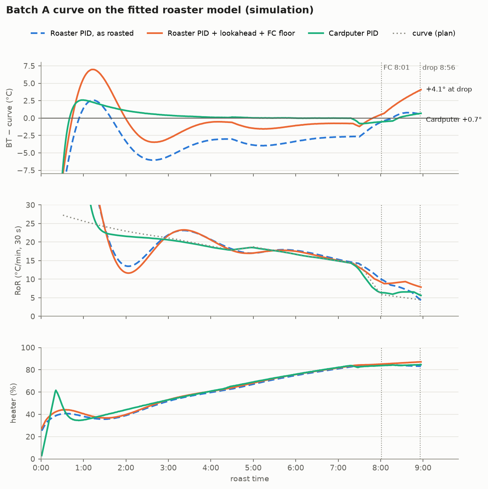

Batch A's curve (first crack 7:30 / 199, drop 10:00 / 210: 2:30 at 4.4 °C/min) as built now, on the fitted model
(`tools/pid/run.sh`; BT − curve RMS from 1:00 to the drop by hand at 8:56; F at 8:01). The chart above is from the
earlier builder.

| | RMS | BT at drop | min RoR after FC |
|---|---|---|---|
| Roaster PID, no lookahead, no floor | 3.2 °C | 204.5 | 3.2 |
| Roaster PID, lookahead 8 s + FC floor +1 °C | 1.9 °C | 207.9 | 5.4 |
| **Cardputer PID** (development from F) | **0.53 °C** | 205.3 | 4.0 |
| Roaster PID, lookahead + floor, model 15 % off, dead time 7 s | 3.4 °C | 208.2 | 5.2 |
| Cardputer PID, model 15 % off, dead time 7 s | 1.6 °C | 205.4 | 4.0 |

The roaster's own PID (registers 20–23: cycle 1000 ms, P 6, I 1, D 8) fits as heat = 0.50 e + 0.036 ∫e dt + 12 %
(R² 0.995–0.998 on all three roasts): an integral time of ~14 s against a ~50 s bean time constant, so it reacts
late and then overshoots.

The roaster PID rows above are kept as the comparison that settled it. Until 2026-11-16 *PID on Cardputer* could be
turned off: Roast then wrote the roaster's target (SV, register 9) once a second, curve(t + *SV lookahead*), held at
least at BT + 1 °C around first crack (*FC floor*). Both are gone with the option. Two curve-follow rules remain:

- **SV lookahead** (0–20 s, default 8): the feedforward aims at curve(t + lookahead), where the curve will be once
  the heater change reaches the beans. Past the curve's end the last value holds.
- **Floor cap** (1–8 °C, default 8): on a curve without first-crack and drop points, F shifts the rest of the curve
  to BT by at most this much.

The log's `target` column records the Cardputer PID's target (the curve now, after F the development).

### Fan floors
The roaster's own minimum fan register reads 50 %. A short press of ↓ stops at **50 %** and again at **40 %**.
To go below a floor, sit on it and hold ↓ for at least 0.6 s. That moves you one step below the floor, and short
presses then work again down to the next floor. The same rule applies to the idle preset and to the 0.1 % steps.

### Rules, alerts and automatic actions
**O** opens the rules, grouped by purpose. Enter edits a value: ← → step it, digits type it, the allowed range is
shown underneath, and range rules (window, rise) take the lower then the upper end. Values are stored in NVS.

| Setting | Default |
|---|---|
| Safety auto-drop temperature | 225 °C |
| Auto-drop after the curve ends | 120 s |
| Low-RoR alert | below 5 |
| Start fan | 53 % |
| Cold temperature | 40 °C |
| Curve offset | 0 °C |
| SV lookahead | 8 s |
| Floor cap (shift at F, curves without FC/DROP) | 8 °C |

The bottom bar turns green ("auto-drop") in the last 10 s or 1 °C of the development. It turns yellow for a heater pinned at 95 % or more for 20 s, or low RoR 30 s after first crack.

On BLE loss the reading greys out and the bar turns red: the roaster keeps the last heater output for ~17–19 s and
then cuts it, so watch for it. Roast then reconnects on its own.

Roast drops by itself at the end of the development (time or drop temperature, see
[Curves and development](#curves-and-development)), and as safety nets at BT at or above the safety temperature or
when the curve ended more than *auto-drop after end* seconds ago.

### Curve editor
The editor has three rows: **Start** (charge temperature), **Crack** and **Drop** (time and temperature). Below the rows it shows the development they set: how long, how fast, how hot at most. It warns when the
development is faster than the roast arrives at first crack ("RoR has to rise into the crack").

- **Enter** (or a digit) edits the row: minutes, Enter, seconds, Enter, temperature, Enter. Tab skips the time.
  First crack must come before the drop and be cooler; the drop is at most 30:00.
- **Space** on Start switches the charge temperature on or off (off: the preset's); Backspace resets it.
- **S** saves to `roast/curves/` on the SD card, **N** renames, **B** sets the batch size.

New curves start at first crack 7:30 / 200 °C and drop 9:00 / 210 °C.

## SD card
Roast requires a writable FAT32 card. If mounting fails, insert the card and press Enter to retry. Charging requires a writable CSV journal.

| Path | Contents |
|---|---|
| `roast/curves/*.json` | Curves (format below). |
| `roast/curves/*.alog` | Artisan or myERoast exports, read-only; `temp2` is the target. |
| `roast/logs/<id>.csv` | One row per second: `t,bt,target,heat,fan,ror,pid,machine_t,heat_cmd,ff,p,i,d,obs`. `pid`: 2 while the Cardputer PID runs, 1 if the roaster's own PID is on, otherwise 0. The last six columns (only with the Cardputer PID) are the heater output written and its feedforward, P, I and D terms, in %, and `obs`: what the self-heating estimate took off the feedforward's rate, °C/min. Marks and actions are lines starting with `#`. |
| `roast/logs/<id>.json` | Roast summary. |
| `roast/logs/<id>.alog` | Opens in Artisan. |

Curve JSON:
```json
{
  "name": "Syrina D 100g",
  "batch_g": 100,
  "points": [
    {"t": 0,   "c": 50,    "tag": "CHARGE"},
    {"t": 425, "c": 200.1, "tag": "FCs"},
    {"t": 470, "c": 208.5, "tag": "DROP"}
  ]
}
```
- `t` is in seconds and `c` is in °C. This one plans first crack at 7:05 / 200.1 °C and 45 s of development at
  11.2 °C/min, at most 208.5 °C.
- Only `CHARGE`, `FCs` and `DROP` are used; other tags, untagged points and `total_s` in older files are ignored.

## Protocol notes (E-Meter621 BLE)
- **GATT:** service `FFF0`.
  - Commands are written to `FFF1` (write-without-response + notify).
  - Replies arrive as notifications on `FFF2` (notify + read). Read directly, `FFF2` returns the device name.
  - The phone app's code mentions `FFE0`/`FFE1`, but this module exposes `FFF0`.
- **Framing:** Modbus RTU, slave 1. Registers are read with FC03 and written with FC06. A write is confirmed when
  the device echoes it back.
- **Registers** (values are ×10 unless noted):

  | Register | Meaning |
  |---|---|
  | 2 | roast timer (s) |
  | 4 | BT |
  | 9 | PID target |
  | 11 | heater % |
  | 12 | fan % |
  | 13 | `1` = start |
  | 14 | `2` = drop, `1` = stop |
  | 15 | PID on/off |
  | 16 | fan output |
  | 20 | PID cycle |
  | 21–23 | P/I/D |
  | 28 | minimum fan |
  | 29 | maximum heater |

- **Pairing:** the module does not answer SMP pairing. The ESP-IDF demo config sets `CONFIG_BT_NIMBLE_SM_LVL=2`,
  which makes NimBLE silently drop notifications on unencrypted links. Roast sets `ble_hs_cfg.sm_sec_lvl = 0`
  while its link is up and restores it afterwards.
- **Timing:** Roast reads about 2.8 frames/s. Commands are retried up to 3 times with a 2 s echo timeout, and
  15 s without data counts as a lost link.

## Parity with the phone app
The phone app's JavaScript was run in Node and compared with this C++ code case by case.

| Area | Match |
|---|---|
| Curve generation | **No longer the same.** The phone app cuts the preset to the total time and stretches it linearly between nodes, which puts a rate-of-rise step at every node. Roast stretches the preset smoothly onto first crack and continues at the development rate ([Curves and development](#curves-and-development)). |
| RoR | \|BT − BT 29 readings earlier\| ÷ 0.5, shown after 35 s. |
| Curve time base | Machine timer (register 2), falling back to the local timer if they differ by more than 5 s. |
| Commands | Same registers and values for start, fan ±1, drop and stop. |

Deliberate differences:
- With a curve the roaster's own PID stays off: Roast writes the heater output (register 11) once a second
  (Cardputer PID). The first target still goes to register 9 at charge, for the roaster's display.
- A roast needs a curve.
- The curve end does not force a drop (see *auto-drop after end*); the end of the development does.
- Curves are built smoothly from first crack and drop only (see above).

Not implemented:
- the phone app's automatic fan schedule;
- writing run parameters (registers 20–29).

## Building
ESP-IDF **v5.5**:
```sh
python3 fetch_repos.py        # clones M5GFX, M5Unified, mooncake, ... into components/
idf.py build                  # -> build/cardputer-roast.bin (the ESP Hub native app image)
```
CI uses `espressif/idf:v5.5`. Main releases are `v0.4.<commit count>`; tagged builds use their tag. Manual branch runs publish an `esphub-<short sha>` prerelease. Each release contains the application `.bin`, `SHA256SUMS`, and an ESP Hub deployment manifest (`esphub.json`). Version comes from `ROAST_VERSION` → `PROJECT_VER`.

### Desktop preview
The UI can be checked without the device. `tools/preview/` compiles the real Roast code (pages, keys, curves,
logs and the simulator) against a stand-in HAL and a fake clock, plays a scripted roast on the simulator and writes
every page as a 240×135 PNG:
```sh
export IDF_PATH=~/esp/esp-idf-v5.5      # for cJSON
tools/preview/build.sh && build_preview/preview build_preview/shots
python3 tools/preview/sheet.py build_preview/shots sheet.png   # optional contact sheet (Pillow)
```
CI uploads the same screenshots as the `ui-preview` artifact.

### Fonts
The UI uses Space Grotesk (SIL OFL 1.1, `tools/fonts/OFL.txt`) as anti-aliased VLW fonts compiled into the
firmware. `python3 tools/fonts/make_vlw.py` regenerates `main/apps/app_roast/fonts/roast_fonts_data.h` (Pillow).

## Host tests
```sh
IDF_PATH=... tools/tests/run.sh                           # roast_control and update unit tests (also in CI)
IDF_PATH=... tools/pid/run.sh                             # PID replays and the competition-roast gate (also in CI)
build_preview/preview shots fcA <lookahead> <tag> [cap x10]   # batch A replay in the preview, chart shots
```

## USB serial debug console
The app listens on the USB serial port. `tools/rdbg.py` drives it:
```sh
python3 tools/rdbg.py key s wait 2 shot prep.png
python3 tools/rdbg.py raw regs 2
python3 tools/rdbg.py raw 'ls /sdcard/roast/logs' 2
```
The console accepts:
- key presses and holds, and typed text;
- full-screen (240×135) screenshots;
- `ping` and `regs`;
- SD listing (`ls`), file dump (`cat`), file removal under `/sdcard/roast/` (`rm`) and card info (`sdinfo`);
- `b64 <file> <offset> <length>` (a file range in base64);
- `net` (Wi-Fi & Dropbox setup state and heap; no credentials).

## License
[MIT](LICENSE). Built on the M5Stack [M5Cardputer-UserDemo](https://github.com/m5stack/M5Cardputer-UserDemo)
(`CardputerADV` branch, MIT), whose notice is kept in `LICENSE`. Third-party parts keep their own licenses:
- Space Grotesk font: SIL Open Font License 1.1 (`tools/fonts/OFL.txt`);
- `main/hal/Panel_ILI9341.hpp`, from LovyanGFX: FreeBSD license (in the file's header);
- M5GFX, M5Unified, mooncake and mooncake_log, fetched by `fetch_repos.py`: see their repositories.

Everything else in this repository, including the dark-roast preset table in
`main/apps/app_roast/preset_dark.h`, is released under the MIT license.

Application packaging targets the ESP Hub Cardputer ADV application slot.
