# Cardputer Roast

**English** | [中文](README_zh.md)

Cardputer Roast turns an **M5Stack Cardputer ADV** into a pocket controller for the **E-Roast / E-Meter621 BLE**
fluid-bed coffee roaster (the machine normally driven by the *myERoast* phone app). It talks to the roaster over
Bluetooth LE, follows a roast curve with its own PID (or the roaster's), and walks you through a roast on the 240×135
screen: charge, drying, first crack, development, drop, cooling, and a summary that is saved to the SD card and
opens in Artisan. It runs as an app under the community [Launcher](https://github.com/bmorcelli/Launcher).

<p>
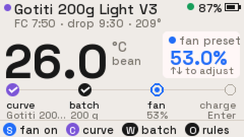
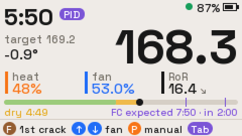
</p>

> **Safety.** This firmware switches a heater on and off. It is not affiliated with or endorsed by the roaster's
> maker, and it was written from observed behaviour, not from vendor documentation. Never leave a roast
> unattended, and keep the machine's own controls within reach.

## Features
- **Curve following.** A PID on the Cardputer (or, if you choose, the roaster's own) follows a curve set by two
  points, first crack and drop (built-in samples, your own curves, or Artisan/myERoast `.alog` files). No curve =
  heat by hand.
- **Development by plan.** The curve's first crack → drop sets the development: how long, how fast (rate of rise)
  and how hot at most. After F, Roast rises at that rate from where the beans actually cracked and drops when the
  time is over or the temperature is reached. Y (yellowing) and G (first crack end) are marks for the log.
- **Alerts and safety nets.** Colour bars for the coming drop, heater pinned or falling after first crack, low RoR
  and BLE loss. The roast itself is silent: alerts are on screen only. Besides the development, Roast drops by
  itself at the safety temperature or long after the curve has ended.
- **Fan control with floors.** Fan ±1 % or ±0.1 %; going below 50 % and 40 % needs a deliberate long press.
- **Manual heat.** P switches between PID and manual heat at any time; ← → step the heater.
- **Curve editor.** Start temperature, first crack and drop (time and temperature), edited on the device with the
  curve and its development beside them, saved to the SD card.
- **Logs.** Every roast is written as `.csv` (1 Hz), `.json` summary and `.alog` for Artisan.
- **Recording.** The built-in microphone records the whole roast, from charge to the end of the log, to a `.wav`
  beside the log. The summary JSON places every mark (dry, first crack, drop) in the recording, for listening back
  to first crack or building a crack-detection dataset.
- **Wi-Fi & Dropbox pairing.** Paired from the [Coffee Watch setup page](https://e7h4n.github.io/coffee-watch/)
  in Chrome over authenticated Bluetooth, like the watch: Wi-Fi network, then your own Dropbox app (App folder access).
  Both are required.
- **Dropbox sync.** Curves live in Dropbox: synced at every boot, and every curve saved or deleted on the device is
  written to Dropbox at once. Each roast's logs (not the recording, which stays on the SD card) are saved to Dropbox from its summary once the fan is off.
- **Simulator.** A built-in thermal model for practising without a machine; a yellow SIM tag shows when it is on.
- **Colour-keyed UI.** Colour = what it controls: fan blue, heat orange, curve/PID violet, marks yellow/brown, drop
  and alarms red, "go" green. The bottom row always shows the keys that work right now.

## Screenshots
Rendered from the firmware's own drawing code by the desktop preview (`tools/preview`), 2× scale.

| | |
|---|---|
| 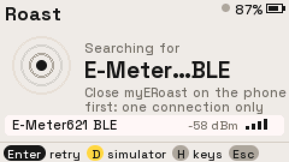 Connect: scans for `E-Meter…BLE` |  Prep: curve → batch → fan → charge |
| 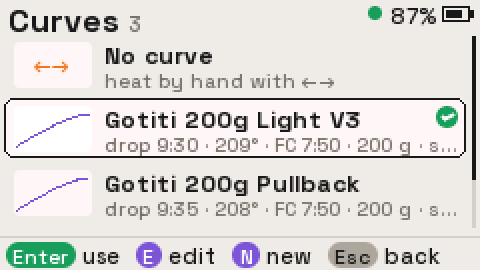 Curve library | 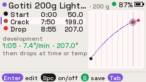 Curve editor: nodes and the curve side by side |
|  Roasting: Maillard, first crack expected | 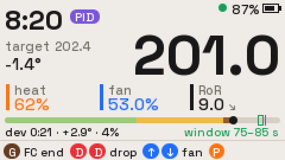 After first crack: development window on the phase bar |
| 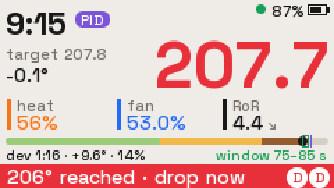 Drop-now temperature reached | 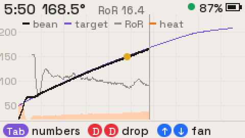 Chart: bean, target, RoR, heater |
| 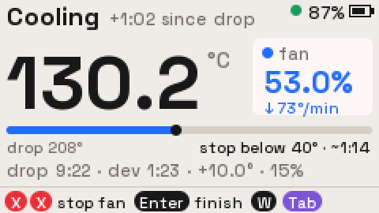 Cooling: progress to the cold temperature | 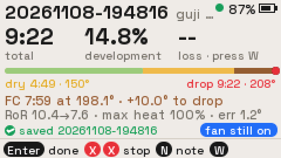 Summary, saved to SD |
| 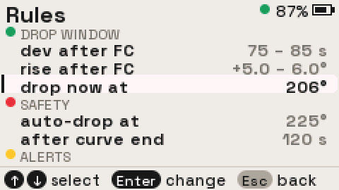 Rules and alerts | 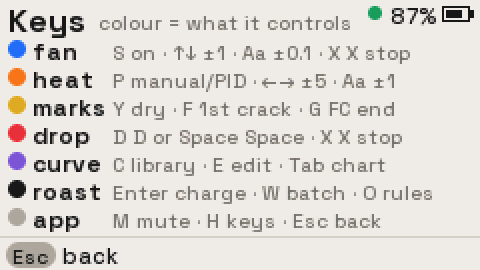 Key map, grouped by colour |

## Install (with Launcher)
1. **Install Launcher** on the Cardputer ADV, with [M5Burner](https://docs.m5stack.com/en/download) or the
   [Launcher web flasher](https://bmorcelli.github.io/Launcher/).
2. **Download `cardputer-roast-<version>.bin`** from the [Releases](../../releases) page (every CI run also keeps
   it as an artifact). It is the bare app image that Launcher installs, not a full-flash image.
3. **Install it from Launcher**, either way:
   - **SD card:** copy the `.bin` to the SD card, open Launcher's SD browser, select the file and install it.
   - **USB serial:** with Launcher in its menu, run
     ```sh
     pip install pyserial
     python3 tools/launcher_flash.py Roast cardputer-roast-<version>.bin
     ```
4. **Optional:** turn on Launcher's boot-to-app setting (CFG) to start Roast at power-on. Esc Esc in Roast then
   shows Launcher's boot screen for about 5 s and reopens Roast.

Insert a FAT32 SD card for curves and logs; without one, the last roast stays in memory until you leave the
summary.

## Using it
Turn the *myERoast* app off first: the roaster accepts only one BLE connection at a time.

Roast scans for a device named `E-Meter…BLE` and connects on its own. To try it without a machine, press **D** on
the connect screen, or switch *simulator* on in Rules (**O**). The simulator can only be switched while the
machine is not running.

**H** shows the key map on every page, grouped by colour. **M** mutes key clicks and chimes. From charge until the
log ends the speaker is always off (see [Recording](#recording)). The top-right corner
shows the battery, the link (green dot) or the SIM tag, a speaker when muted, and a red **SD** tag without a card.

### Prep
The page walks through four steps: curve → batch → fan → charge.

| Key | Action |
|---|---|
| C | Curve library. "No curve" (heat by hand) is the first entry; Enter uses, E edits, N starts a new curve. |
| E | Edit the selected curve (or start a new one). |
| W / B | Batch sheet: green weight and bean name in one place (Tab switches field). |
| O | Rules, alerts and simulator. |
| S | Fan on, no heat. Use it to find a fan setting with cold air before adding beans. |
| ↑ ↓ (`;` `.`) | Fan ±1 % (Aa held: ±0.1 %). While idle this changes only the start-fan preset. |
| Enter | Charge: starts the timer and heater control along the curve (the Cardputer PID by default). Needs the fan on. |
| X X | Stop the fan. |
| Tab | Curve preview. |
| Esc Esc | Back to Launcher. Blocked while the fan is running. |

### Roasting
| Key | Action |
|---|---|
| Y / F / G | Mark drying end / first crack / end of first crack. Press the same key twice more to clear the mark. |
| D D or Space Space | Drop. After the first press the bottom row asks for the second. |
| ↑ ↓ | Fan ±1 % (Aa: ±0.1 %). |
| P | Manual heat: PID off, heater held at its current output. ← → change it by ±5 % (Aa: ±1 %; holding repeats, at most 8 steps per hold). P again returns to the curve. |
| Tab | Numbers / chart (bean black, target violet, RoR grey, heater orange area). |

The phase bar runs through the whole roast: drying (sage) → Maillard (yellow, starts at Y) → development (brown,
starts at F). After first crack it outlines the development (its time; the bar under it shows time, rise and rate). Exit is locked until the drop.

### Cooling and summary
- Cooling shows the fan, the cooling rate and how far the beans are from the cold temperature.
- **X X** stops the fan and opens the summary. **Enter** finishes the log and leaves the fan running; the summary
  then says "fan still on" and **X X** still stops it there (and on Prep afterwards).
- **W** sets the roasted weight; **N** adds a note; **Enter** goes back to Prep.
- The recording stops with the log: Enter or X X on the cooling page, 4 minutes after the drop, or on exit.

The summary shows total time, development percentage and weight loss, the whole roast on the phase bar, first crack
and the rise to drop, RoR at first crack and 30 s later, peak heater output and curve-following error. The
recording's length, clipping and inserted silence are in the summary JSON (`audio`), not on screen.

### Recording
Every roast is recorded when an SD card is present; there is no switch. A red **REC** tag in the status corner
shows while it records. Format: WAV, 32 kHz, 16-bit, mono, about 3.8 MB per minute; a 15-minute roast with cooling is about
60 MB. 32 kHz covers 0–16 kHz, which includes the 2–16 kHz band used in first-crack detection, and leaves enough
memory for the SD write buffer next to BLE.

The speaker is off for the whole roast, from charge until the log ends, whether or not it is recorded: no key
clicks, chimes, warnings or alarms. Every alert is a colour bar on screen. (The microphone and the speaker share one
codec and its clocks and cannot work at the same time; a silent roast also keeps beeps out of the recording.)

The file stays on the roast clock: second N of the WAV is second N after the recording started. If the SD card
stalls for longer than the write buffer, the lost samples are replaced by the same number of zeros, and the JSON
lists each such gap.

*Mic gain* (0–30 dB in 3 dB steps, default 18 dB) is the codec's analog gain. The default is an estimate; if the
JSON's `clipped_samples` is more than a handful, lower it.

### Wi-Fi & Dropbox
**O** (also from the Connect page) › *network* opens the setup screen. It closes the roaster link first (setup needs
Bluetooth for itself), so it is only available with the fan off. **Esc** closes setup and restarts Roast (a few
seconds), which reconnects to the roaster with a clean heap: Bluetooth, Wi-Fi and TLS leave it too fragmented for a
roast log and a recording.

1. In Chrome on a computer or Android phone, open https://e7h4n.github.io/coffee-watch/ and press **Connect watch**.
2. Pick `CardputerRoast-XXXX`. When the system pairing dialog asks, type the six-digit code on the Cardputer.
3. Enter a 2.4 GHz Wi-Fi network. It counts (and is saved) only once the Cardputer has an IP address.
4. Link Dropbox: in the [App Console](https://www.dropbox.com/developers/apps) create an app with Scoped access and
   App folder access, enable `files.content.write`, `files.content.read` and `files.metadata.read`, enter its App key
   and App secret, allow access on Dropbox and paste the code it shows. The Cardputer exchanges the code for a
   refresh token itself and saves it; the page then shows *Authorization saved*. It does not test an upload here
   (with Bluetooth up there is not enough memory for a second HTTPS session): close setup, and the boot sync, which
   runs without Bluetooth, is the first real use of the account. If it is wrong, the sync fails and says why.
   *Check Dropbox upload* on the page only refreshes the token.
   You can reuse the Coffee Watch Dropbox app: both devices then share one app folder.

The protocol, packets and status are the Coffee Watch ones ([spec](https://github.com/e7h4n/coffee-watch/blob/main/spec/dropbox.md)),
ported from its firmware. Credentials go only over the authenticated, encrypted Bluetooth link, are stored in NVS
(`rn_wifi`, `rn_dropbox`; plain flash, no flash encryption) and are never logged or readable over Bluetooth. Wi-Fi,
Bluetooth setup and the TLS buffers run only while this screen is open. Removing Dropbox on the page erases it from
the Cardputer; revoke access under Connected apps in your Dropbox settings.

The rules page shows the saved network and whether Dropbox is linked. Once Dropbox setup has set the clock (SNTP),
new log ids are dated (`YYYYMMDD-HHMMSS`, UTC) instead of `R####`, until the next power-off.

### Dropbox sync
Wi-Fi and Dropbox are required: until both are set up, Roast opens the setup screen at boot. Everything below lives in
the Dropbox app's folder (Dropbox › Apps › *app name*). Every transfer is checked against Dropbox's `content_hash`;
nothing is retried: a failure stops with its reason on screen.

| When | What | Direction |
|---|---|---|
| Every boot, and **S** in the curve library | `Roast Curves/` → `roast/curves/`: the card ends up exactly like the folder at that moment (missing or different files downloaded, others deleted). Must succeed: on failure Roast stays on that screen (**Enter** tries again, **O** network setup, **Esc** exit). | Dropbox → card |
| A curve saved in the editor (**S**) | That one file, overwritten on Dropbox. | card → Dropbox |
| A curve deleted in the library (**Del** twice) | That one file, deleted on Dropbox, then on the card. | card → Dropbox |
| On the summary, once the fan is off | `roast/logs/<id>.csv/.json/.alog` → `Roast Logs/` (not the `.wav`: it stays on the card), overwritten, in the background: the summary stays usable (weight, note, chart). An edit there re-saves the .json and .alog. The summary can be closed only when everything is saved (or the save failed). Afterwards the record is not synced again; Roast has no history view. | card → Dropbox |

Last writer wins: the device pushes its own edits immediately, and the next sync replaces the card's curves with
Dropbox's. The Cardputer has no PSRAM, and BLE, Wi-Fi and TLS do not fit together, so each of these closes the roaster
link while it runs and Roast restarts afterwards (a few seconds; the boot after a sync or a push skips the curve
sync). That is why saving or deleting a curve and saving a roast need the fan off (**X X** first). A roast's save takes
a few seconds. The recording is not uploaded: about 55 MB for a 14-minute roast took ~10 minutes over Wi-Fi with
the summary blocked; read it from the SD card or over USB (`tools/pull_audio.py`). While anything syncs, the status corner says
**Syncing** in place of the battery; the sync screen shows details only when it failed.

### Curves and development
A curve is two points, **first crack** and **drop** (time and temperature), plus the charge temperature (default
50 °C). Yellowing is not a curve point: Y marks it during the roast, for the log. Older files keep working: their
`FCs` and `DROP` points are used, everything else (`DRY`, `FCe`, `SCs`, `SCe`, untagged points, `total_s`) is
ignored.

The two points set the **development**, the part that matters most:

| | from the curve | e.g. Syrina D 100g |
|---|---|---|
| how long | drop time − first-crack time | 45 s |
| how fast | (drop − first-crack temperature) ÷ that time | 11.2 °C/min |
| how hot at most | drop temperature | 208.5 °C |

**When F is pressed**, the target rises at that rate from the beans' temperature at F, and **Roast drops when the
time is over or BT reaches the drop temperature**, whichever comes first. This is not a setting. A crack later or
hotter than planned therefore drops early on temperature (in the simulation below, 20–26 s after F instead of
45 s); one cooler than planned runs the full time and ends below the drop temperature. Without F, Roast drops at
the drop temperature or at the curve's drop time. Pressing F twice clears it and goes back to the curve. Both
controllers follow the development (the roaster PID through SV). A bar says "auto-drop" in the last 10 s or 1 °C.

`roast_curve.cpp` builds the 1 Hz target:

- **Charge → first crack:** the vendor's dark-roast preset, a smooth curve with the rate of rise falling from ~27 to
  ~10 °C/min, stretched in time and temperature so it starts at the charge temperature and passes through first
  crack. Before first crack its rate of rise blends smoothly into the development rate (over a minute, longer for a
  bigger change), so there is no corner at first crack. The editor warns if the rate would have to go *up* into the
  crack.
- **First crack → drop:** a straight line at the development rate.

No corners anywhere: the myERoast-style builder added straight-line corrections at every mark, which put a
rate-of-rise step at each one (−4.5 °C/min at first crack on Syrina D 100g). On batches A and B that step, with BT
2–3 °C behind the line, carried BT over the target and the roaster's PID cut the heater by ~5 %: the rate of rise
fell from ~18 to ~0 (R0012, R0013).

On Syrina D 100g as planned for the competition (first crack 7:05 / 200.1, 45 s at 11.2 °C/min, at most
208.5 °C), in `tools/pid` (`fc_crack`), against the previous firmware (the cornered curve, drop by hand at F + 45 s):

| Crack | previous | this |
|---|---|---|
| on time | 45 s, +6.6 to 207.1, RoR down to 8.4 | 43 s, +8.0, at **208.5**, RoR 11.1 |
| 15 s early | 45 s, +8.4 to 204.9 | 45 s, +8.4 to 204.9 |
| 15 s late | 35–37 s, to 208.5–209.4 | 20–26 s, at **208.5**, RoR at the planned 11.1–11.5 |

In all nine cases (crack with no heat effect, absorbing, or releasing heat) the rate of rise follows the plan as
well or better (mean |RoR − plan| 0.00–0.58 against 0.02–1.04).

**The first real roast (2026-11-14, Syrina D, 100 g)** on that firmware went too fast: BT ran 1.5–2 °C ahead of the
curve from 6:00, F at 7:09 at 202.9, and the development averaged 15.5 °C/min (RoR 17 at the drop) instead of 11.2;
it dropped on temperature after 24 s. Whole bean 71.2, ground ~87 (RD 16.7): the outside much darker than the
inside. Two causes, both fixed: near first crack the beans heat faster than the heater model said (now in the model,
see *Feedforward*), and the hold before F let BT run ahead uncorrected (removed). Replayed on a plant fitted to that
roast (`tools/pid`, `syrina_1114`), the old firmware reproduces it (F 7:09, drop after 24 s, 13.5 °C/min); this one
reaches the crack 0.4 °C ahead instead of 2.3 and holds 11.2 °C/min to the drop. Those beans crack at ~203 °C,
though, so a 208.5 °C limit still leaves only ~30 s at 11.2 °C/min: that is the curve's to change.

### Curve following: the Cardputer PID
By default the Cardputer sets the heater itself (Rules › CURVE FOLLOW › *PID on Cardputer*). At charge it switches
the roaster's own PID off (register 15 = 0) and then writes the heater output (register 11) once a second
(`roast_control.h`, `PidStep`):

    heat = feedforward + P × (e + ∫e dt / Ti + Td × (planned rate − dBT/dt)),   e = target(t) − BT

- **Feedforward** comes from a heater → bean model fitted on R0012–R0014 (2026-11-12) and the 2026-11-14 Syrina D
  roast (fan 53–54 %, 100 g and 200 g). The inlet air settles at about 26 °C + 2.13 °C per % heat, and the beans
  approach it with a ~49 s time constant, starting ~5 s after a heater change. On top of that they heat themselves
  from ~156 °C on, by 0.25 °C/min per degree: ~11 °C/min at first crack, worth 4–5 % heat (exothermic reactions,
  better heat transfer as the beans dry and expand, or the probe: the data do not tell them apart). Without that
  term the feedforward gave too much heat near first crack and the beans ran ahead (the 2026-11-14 roast). The
  model gives the heat the curve needs at curve(t + lookahead) with the curve's slope there, so the PI only trims.
  Replayed through the fitted roaster PID, it reproduces batch A within 1.2 °C RMS. Beans differ (the 11-14
  Syrina heated itself harder): the integral covers the rest. A rule of thumb: 1 % heat ≈ 2.6 °C/min of RoR.
- **PI(D)**, measured against the curve *now*:
  - Defaults: P 1.5 %/°C, I time 60 s, D time 0, *D after F* 0.
  - D acts on the rate-of-rise shortfall: the curve's slope now minus BT's slope (5 s filter). The curve's slope
    has no steps, so nothing kicks when the target shifts at F. Before F it stays off: on batch A it doubled the
    heater's movement and the error.
  - The heater moves at most 3 %/s.
  - Anti-windup: the integral stops while the output is pinned or slew-limited, and is capped at ±30 %.
  - At charge the controller starts from 0 % with no integral. When P hands back from manual, it picks up the
    heat being held (bumpless).
- **First crack.**
  - *Before F* the curve is followed as everywhere else. (A hold, BT above the curve counting as no error, was
    removed after the 2026-11-14 roast: it let BT run 2 °C ahead into the crack.)
  - *At F*: the development (above) becomes the target, and the controller is re-primed so the heater does not
    jump. A curve without first crack and drop points is shifted to BT instead (within ± *floor cap*).
  - *After F*, optional (*D after F*, off by default): D acts on the rate of rise against the development rate.
    In the 2026-11-14 replay it made the development a little faster rather than steadier (11.4 and 11.8 °C/min
    against 11.2 without), so it stays off.
  - With the heater already at 100 % no controller can lift the rate of rise. That has to be planned in the curve;
    the "heater pinned" alert shows it.
- **Stale reading:** if BT is more than 3 s old, the output is held.
- **Drop:** cancels any heater write still queued, so it cannot land after the drop. In manual mode the roaster
  zeroes the heater at drop (seen in R0014).

> **Link loss.** With the Cardputer PID the roaster's PID is off. Tested on the machine (empty, 2026-11-13): when
> Bluetooth dropped, the roaster kept its fan and timer and kept heating at the last output for ~17–19 s, then cut
> the heater by itself; heating resumed with the next write after the reconnect. Roast re-sends the heater every
> 5 s even when it does not change. Stay with the roast, as always.

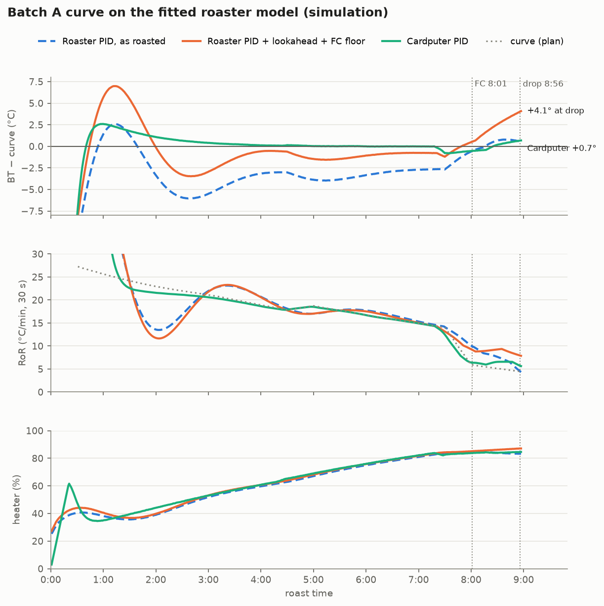

Batch A's curve (first crack 7:30 / 199, drop 10:00 / 210: 2:30 at 4.4 °C/min) as built now, on the fitted model
(`tools/pid/run.sh`; BT − curve RMS from 1:00 to the drop by hand at 8:56; F at 8:01). The chart above is from the
earlier builder.

| | RMS | BT at drop | min RoR after FC |
|---|---|---|---|
| Roaster PID, no lookahead, no floor | 3.2 °C | 204.5 | 3.2 |
| Roaster PID, lookahead 8 s + FC floor +1 °C | 1.9 °C | 207.9 | 5.4 |
| **Cardputer PID** (development from F) | **0.53 °C** | 205.4 | 4.4 |
| Roaster PID, lookahead + floor, model 15 % off, dead time 7 s | 3.4 °C | 208.2 | 5.2 |
| Cardputer PID, model 15 % off, dead time 7 s | 1.7 °C | 206.0 | 4.0 |

The roaster's own PID (registers 20–23: cycle 1000 ms, P 6, I 1, D 8) fits as heat = 0.50 e + 0.036 ∫e dt + 12 %
(R² 0.995–0.998 on all three roasts): an integral time of ~14 s against a ~50 s bean time constant, so it reacts
late and then overshoots.

**Roaster PID** (*PID on Cardputer* off): Roast writes the roaster's target (SV, register 9) once a second and the
roaster's PID sets the heater. Two rules shape SV:

- **SV lookahead** (0–20 s, default 8): SV = curve(t + lookahead). The PID acts late (heater → air → beans), so it
  aims where the curve will be. Artisan follows a background curve the same way. Past the curve's end the last
  value holds. With the Cardputer PID, the lookahead applies to the feedforward only.
- **FC floor** (default on): in the first-crack window, SV is never below BT + *floor above BT* (default 1 °C), so
  the PID does not cut heat just to get back onto the line. The floor is capped at curve(t) + *floor cap*. With an
  integral this keeps pushing BT up: about +4 °C over the curve at the drop in the simulator, and up to +8.6 °C
  with an +8 °C cap. Drop-now and the safety drop are unchanged. The first time the floor lifts SV it is logged as
  an action; the Roast page then shows "FC floor SV …" (with the Cardputer PID: "FC hold: heat on plan").

The log's `target` column records the SV written (with the Cardputer PID: its target, the curve now). **P** (manual heat) holds the heater at its mean over the
last 30 s rather than one reading.

### Fan floors
The roaster's own minimum fan register reads 50 %. A short press of ↓ stops at **50 %** and again at **40 %**.
To go below a floor, sit on it and hold ↓ for at least 0.6 s. That moves you one step below the floor, and short
presses then work again down to the next floor. The same rule applies to the idle preset and to the 0.1 % steps.

### Rules, alerts and automatic actions
**O** opens the rules, grouped by purpose. Enter edits a value: ← → step it, digits type it, the allowed range is
shown underneath, and range rules (window, rise) take the lower then the upper end. Values are stored in NVS.

| Setting | Default |
|---|---|
| Safety auto-drop temperature | 225 °C |
| Auto-drop after the curve ends | 120 s |
| Low-RoR alert | below 5 |
| Heat-drop-after-FC alert | 5 % |
| Start fan | 53 % |
| Cold temperature | 40 °C |
| Curve offset | 0 °C |
| SV lookahead | 8 s |
| FC floor | on |
| Floor above BT | 1 °C |
| Floor cap (above the curve) | 8 °C |
| Mic gain | 18 dB |

The bottom bar turns green ("auto-drop") in the last 10 s or 1 °C of the development. It turns yellow for a heater pinned at 95 % or more for 20 s, heater output falling after first
crack, or low RoR 30 s after first crack.

On BLE loss the reading greys out and the bar turns red: the roaster keeps heating to the last target, so watch
for it. Roast then reconnects on its own.

Roast drops by itself at the end of the development (time or drop temperature, see
[Curves and development](#curves-and-development)), and as safety nets at BT at or above the safety temperature or
when the curve ended more than *auto-drop after end* seconds ago.

### Curve editor
The editor has three rows: **Start** (charge temperature), **Crack** and **Drop** (time and temperature), with the
curve beside them and, under them, the development they set: how long, how fast, how hot at most. It warns when the
development is faster than the roast arrives at first crack ("RoR has to rise into the crack").

- **Enter** (or a digit) edits the row: minutes, Enter, seconds, Enter, temperature, Enter. Tab skips the time.
  First crack must come before the drop and be cooler; the drop is at most 30:00.
- **Space** on Start switches the charge temperature on or off (off: the preset's); Backspace resets it.
- **S** saves to `roast/curves/` on the SD card, **N** renames, **B** sets the batch size, **Tab** previews.

New curves start at first crack 7:30 / 200 °C and drop 9:00 / 210 °C.

## SD card
The card must be FAT32. Without one, logs live only in memory until the summary is closed.

| Path | Contents |
|---|---|
| `roast/curves/*.json` | Curves (format below). |
| `roast/curves/*.alog` | Artisan or myERoast exports, read-only; `temp2` is the target. |
| `roast/logs/<id>.csv` | One row per second: `t,bt,target,heat,fan,ror,pid,machine_t,heat_cmd,ff,p,i,d`. `pid`: 0 manual, 1 roaster PID, 2 Cardputer PID. The last five columns (only with the Cardputer PID) are the heater output written and its feedforward, P, I and D terms, in %. Marks and actions are lines starting with `#`. |
| `roast/logs/<id>.json` | Roast summary. |
| `roast/logs/<id>.alog` | Opens in Artisan. |
| `roast/logs/<id>.wav` | The roast's recording (32 kHz, 16-bit, mono). Samples start at byte 512. |

Curve JSON:
```json
{
  "name": "Syrina D 100g",
  "batch_g": 100,
  "points": [
    {"t": 0,   "c": 50,    "tag": "CHARGE"},
    {"t": 425, "c": 200.1, "tag": "FCs"},
    {"t": 470, "c": 208.5, "tag": "DROP"}
  ]
}
```
- `t` is in seconds and `c` is in °C. This one plans first crack at 7:05 / 200.1 °C and 45 s of development at
  11.2 °C/min, at most 208.5 °C.
- Only `CHARGE`, `FCs` and `DROP` are used; other tags, untagged points and `total_s` in older files are ignored.

The summary JSON has an `audio` object when the roast was recorded:
```json
"audio": {
  "file": "R0012.wav", "format": "wav pcm 16-bit mono", "sample_rate": 32000, "mic_gain_db": 18,
  "start_ms_after_charge": 4, "duration_s": 812.37, "peak_dbfs": -7.9, "clipped_samples": 0, "buffer_ms": 896,
  "i2s_slot": "right",
  "events_ms": {"charge": 0, "dry": 284996, "fc_start": 471512, "fc_end": 529870, "drop": 569004},
  "silence": []
}
```
`events_ms` are positions in the WAV file. `silence` lists gaps filled with zeros (`{"at_ms", "ms"}`) where the SD
card stalled for longer than the buffer (`buffer_ms`); normally it is empty.

## Protocol notes (E-Meter621 BLE)
- **GATT:** service `FFF0`.
  - Commands are written to `FFF1` (write-without-response + notify).
  - Replies arrive as notifications on `FFF2` (notify + read). Read directly, `FFF2` returns the device name.
  - The phone app's code mentions `FFE0`/`FFE1`, but this module exposes `FFF0`.
- **Framing:** Modbus RTU, slave 1. Registers are read with FC03 and written with FC06. A write is confirmed when
  the device echoes it back.
- **Registers** (values are ×10 unless noted):

  | Register | Meaning |
  |---|---|
  | 2 | roast timer (s) |
  | 4 | BT |
  | 9 | PID target |
  | 11 | heater % |
  | 12 | fan % |
  | 13 | `1` = start |
  | 14 | `2` = drop, `1` = stop |
  | 15 | PID on/off |
  | 16 | fan output |
  | 20 | PID cycle |
  | 21–23 | P/I/D |
  | 28 | minimum fan |
  | 29 | maximum heater |

- **Pairing:** the module does not answer SMP pairing. The ESP-IDF demo config sets `CONFIG_BT_NIMBLE_SM_LVL=2`,
  which makes NimBLE silently drop notifications on unencrypted links. Roast sets `ble_hs_cfg.sm_sec_lvl = 0`
  while its link is up and restores it afterwards.
- **Timing:** Roast reads about 2.8 frames/s. Commands are retried up to 3 times with a 2 s echo timeout, and
  15 s without data counts as a lost link.

## Parity with the phone app
The phone app's JavaScript was run in Node and compared with this C++ code case by case.

| Area | Match |
|---|---|
| Curve generation | **No longer the same.** The phone app cuts the preset to the total time and stretches it linearly between nodes, which puts a rate-of-rise step at every node. Roast stretches the preset smoothly onto first crack and continues at the development rate ([Curves and development](#curves-and-development)). |
| RoR | \|BT − BT 29 readings earlier\| ÷ 0.5, shown after 35 s. |
| Curve time base | Machine timer (register 2), falling back to the local timer if they differ by more than 5 s. |
| Commands | Same registers and values for start, charge without a curve, fan ±1, drop, stop, and the per-second target write. |

Deliberate differences:
- Charging with a curve writes the first target (register 9) before starting the PID.
- Turning PID off also writes the current heater value (register 11), so the output does not jump.
- P re-enables PID mid-roast.
- Heater steps are sent only in manual mode.
- The curve end does not force a drop (see *auto-drop after end*); the end of the development does.
- Curves are built smoothly from first crack and drop only (see above).

Not implemented:
- the phone app's automatic fan schedule;
- writing run parameters (registers 20–29).

## Building
ESP-IDF **v5.4.2**:
```sh
python3 fetch_repos.py        # clones M5GFX, M5Unified, mooncake, ... into components/
idf.py build                  # -> build/cardputer-roast.bin (the Launcher app image)
```
CI does the same in the `espressif/idf:v5.4.2` container. Pushing a `v*` tag publishes a release with the `.bin`
attached.

### Desktop preview
The UI can be checked without the device. `tools/preview/` compiles the real Roast code (pages, keys, curves,
logs and the simulator) against a stand-in HAL and a fake clock, plays a scripted roast and writes every page as
a 240×135 PNG:
```sh
export IDF_PATH=~/esp/esp-idf-v5.4.2      # for cJSON
tools/preview/build.sh && build_preview/preview build_preview/shots
python3 tools/preview/sheet.py build_preview/shots sheet.png   # optional contact sheet (Pillow)
```
CI uploads the same screenshots as the `ui-preview` artifact.

### Fonts
The UI uses Space Grotesk (SIL OFL 1.1, `tools/fonts/OFL.txt`) as anti-aliased VLW fonts compiled into the
firmware. `python3 tools/fonts/make_vlw.py` regenerates `main/apps/app_roast/fonts/roast_fonts_data.h` (Pillow).

## Host tests and the simulator sweep
```sh
IDF_PATH=... tools/tests/run.sh                                   # roast_control unit tests (also in CI)
tools/preview/build.sh && tools/preview/build_sweep.sh && build_preview/fc_sweep   # floor/cap/lookahead sweep
build_preview/preview shots fcA <floor 0|1> <lookahead> <tag> [cap x10]           # batch A replay, chart shots
```

## USB serial debug console
The app listens on the USB serial port. `tools/rdbg.py` drives it:
```sh
python3 tools/rdbg.py quiet key s wait 2 shot prep.png
python3 tools/rdbg.py raw regs 2
python3 tools/rdbg.py raw 'ls /sdcard/roast/logs' 2
```
The console accepts:
- key presses and holds, and typed text;
- full-screen (240×135) screenshots;
- `quiet`, `ping` and `regs`;
- SD listing (`ls`), file dump (`cat`), file removal under `/sdcard/roast/` (`rm`) and card info (`sdinfo`);
- `rec` (recorder state and levels) and `b64 <file> <offset> <length>` (a file range in base64);
- `net` (Wi-Fi & Dropbox setup state and heap; no credentials).

`tools/pull_audio.py <id> [seconds]` pulls the start of a recording over USB and prints peak and RMS level and the
share of inserted silence for every second, with the marks from the JSON. It manages about 1 s of audio per
1–2 s, so take the SD card out for whole roasts.

## License
[MIT](LICENSE). Built on the M5Stack [M5Cardputer-UserDemo](https://github.com/m5stack/M5Cardputer-UserDemo)
(`CardputerADV` branch, MIT), whose notice is kept in `LICENSE`. Third-party parts keep their own licenses:
- Space Grotesk font: SIL Open Font License 1.1 (`tools/fonts/OFL.txt`);
- M5GFX, M5Unified, mooncake, mooncake_log and smooth_ui_toolkit, fetched by `fetch_repos.py`: see their
  repositories.

Everything else in this repository, including the dark-roast preset table in
`main/apps/app_roast/preset_dark.h`, is released under the MIT license.

App packaging targets [bmorcelli/Launcher](https://github.com/bmorcelli/Launcher).
