# Cardputer Roast

[English](README.md) | **中文**

Cardputer Roast 把 **M5Stack Cardputer ADV** 变成 **E-Roast / E-Meter621 BLE** 流化床咖啡烘豆机的随身控制器（这台机器原本用手机 App *myERoast* 控制）。它通过蓝牙 BLE 和烘豆机通信，由 Cardputer 上的 PID（也可以选烘豆机自带的）跟随烘焙曲线，并在 240×135 的屏幕上带你走完一锅：投豆、脱水、一爆、发展、排豆、冷却，最后生成总结。记录存到 SD 卡，可以直接导入 Artisan。它作为社区 [Launcher](https://github.com/bmorcelli/Launcher) 下的一个 app 运行。

<p>
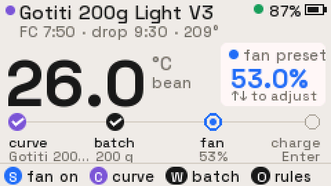
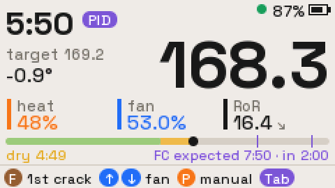
</p>

> **安全提示。** 本固件会控制加热器的开关。它与烘豆机厂家无关，也未经厂家认可，是根据实际观察到的设备行为编写的，不是依据厂家文档。烘焙时请勿离人，并确保随时能操作机器本身的控制按键。

## 功能
- **跟随曲线。** Cardputer 上的 PID（也可以选烘豆机自带的）跟随目标曲线，曲线的计算方式和手机 App 完全一致。曲线可以是内置示例、自己编辑的曲线，或 Artisan / myERoast 导出的 `.alog` 文件；也可以不用曲线，手动控制火力。
- **打点和发展窗口。** Y / F / G 分别标记脱水结束、一爆开始和一爆结束。一条阶段条贯穿整锅；一爆之后，阶段条上会框出排豆窗口（时间和升温两个条件）。
- **提醒和安全兜底。** 用整条彩色底栏提示：进入排豆窗口、到达立即排豆温度、发展超时、火力顶满或一爆后火力下降、RoR 过低、蓝牙断开。烘焙全程静音，提醒只在屏幕上显示。只有在豆温达到安全上限，或曲线结束很久之后，才会自动排豆。
- **带保护的风力控制。** 风力每次调 1% 或 0.1%；要降到 50% 和 40% 以下，必须特意长按。
- **手动火力。** 按 P 随时在 PID 和手动火力之间切换，← → 调节火力。
- **曲线编辑器。** 和手机 App 一样的 8 个节点（初始、脱水、一爆始/末、二爆始/末、排豆、总用时），直接在设备上编辑，表格旁边实时显示曲线，保存到 SD 卡。
- **烘焙记录。** 每锅都会保存 `.csv`（每秒一行）、`.json` 总结，以及可导入 Artisan 的 `.alog`。
- **全程录音。** 用机身麦克风从投豆录到记录结束，`.wav` 和曲线记录放在一起。总结 JSON 里标出每个打点（脱水、一爆、排豆）在录音里的位置，方便回听一爆，或者整理一爆识别的数据集。
- **Wi-Fi 和 Dropbox 配对。** 和手表一样，在 Chrome 里打开 [Coffee Watch 配置页](https://e7h4n.github.io/coffee-watch/)，通过加密蓝牙配好 Wi-Fi 和你自己的 Dropbox app（App folder 权限）。两者都是必需的。
- **Dropbox 同步。** 曲线以 Dropbox 为准：每次开机同步一次，在设备上保存或删除曲线会马上写回 Dropbox。每锅的记录在总结页、风机关掉之后存到 Dropbox（录音不上传，留在 SD 卡里）。
- **模拟器。** 内置简单的热学模型，没有机器也能练习；开启时右上角显示黄色 SIM 标签。
- **按功能着色的界面。** 颜色 = 它控制什么：风机蓝、火力橙、曲线/PID 紫、打点黄/棕、排豆和报警红、"可以进行"绿。底栏永远显示当前能按的键。

## 截图
以下截图由桌面预览工具（`tools/preview`）运行固件自身的绘制代码生成，放大 2 倍。

| | |
|---|---|
| 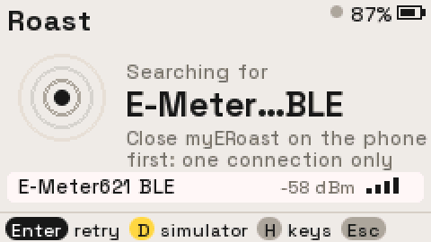 连接页：搜索 `E-Meter…BLE` |  准备页：曲线 → 批次 → 开风 → 投豆 |
| 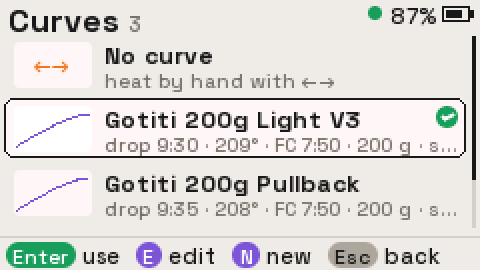 曲线库 | 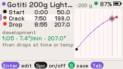 曲线编辑器：节点表和曲线并排 |
|  烘焙中：美拉德阶段，显示预计一爆 | 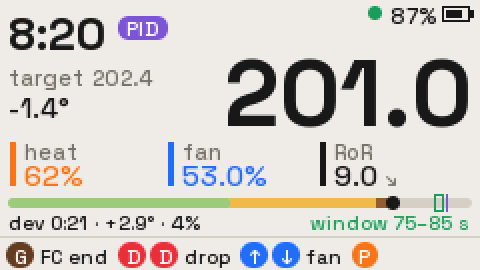 一爆后：阶段条上框出发展窗口 |
| 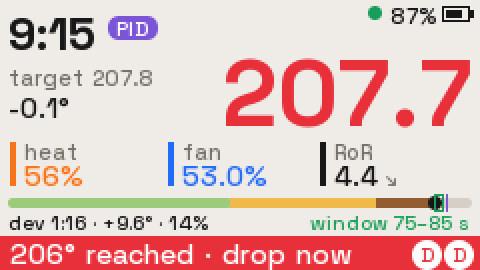 到达立即排豆温度 | 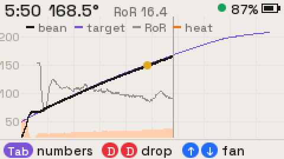 曲线图：豆温、目标、RoR、火力 |
| 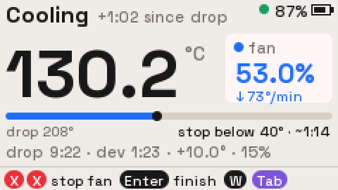 冷却：降到冷机温度的进度 | 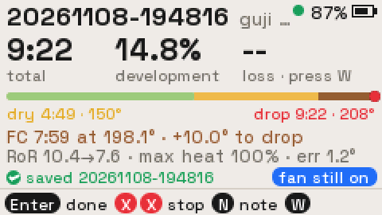 总结，已保存到 SD 卡 |
| 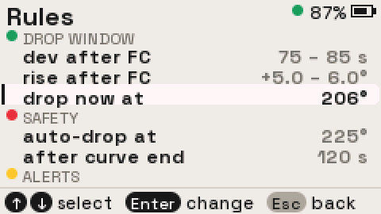 规则与提醒 | 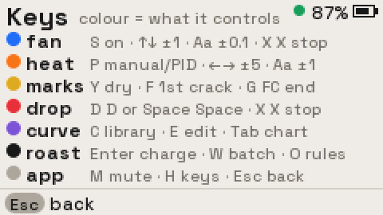 按键页，按颜色分组 |

## 安装（通过 Launcher）
1. **安装 Launcher：** 用 [M5Burner](https://docs.m5stack.com/en/download) 或 [Launcher 网页刷机工具](https://bmorcelli.github.io/Launcher/) 给 Cardputer ADV 刷入 Launcher。
2. **下载 `cardputer-roast-<版本>.bin`：** 在 [Releases](../../releases) 页面下载（每次 CI 运行也会保留一份附件）。这是 Launcher 安装用的 app 镜像，不是整片刷写镜像。
3. **在 Launcher 里安装**，两种方式任选：
   - **SD 卡：** 把 `.bin` 拷到 SD 卡，在 Launcher 里打开 SD 文件浏览，选中文件安装。
   - **USB 串口：** 让 Launcher 停在菜单界面，然后运行
     ```sh
     pip install pyserial
     python3 tools/launcher_flash.py Roast cardputer-roast-<版本>.bin
     ```
4. **可选：** 在 Launcher 设置（CFG）里打开开机直接进入 app，这样一开机就进 Roast。之后在 Roast 里按两次 Esc，会先显示约 5 秒 Launcher 启动画面，然后自动回到 Roast。

请插入 FAT32 格式的 SD 卡来存放曲线和记录。没有 SD 卡时，最近一锅的记录只保存在内存里，离开总结页就没有了。

## 使用说明
先关掉手机上的 *myERoast*：烘豆机同一时间只接受一个蓝牙连接。

Roast 会自动搜索名为 `E-Meter…BLE` 的设备并连接。没有机器想先试用，可以在连接页按 **D**，或在规则页（**O**）里打开 *simulator*（模拟器）。只有机器没在运行时才能切换模拟器。

任何页面按 **H** 都能看到按颜色分组的按键说明。**M** 关闭按键音和提示音。从投豆到这锅记录结束，喇叭始终不响（见[录音](#录音)）。右上角显示电量、连接状态（绿点）或 SIM 标签；静音时显示喇叭图标，没插 SD 卡时显示红色 **SD** 标签。

### 准备页
页面按四步引导：曲线 → 批次 → 开风 → 投豆。

| 按键 | 作用 |
|---|---|
| C | 曲线库。第一项是"不用曲线"（手动火力）；Enter 选用，E 编辑，N 新建曲线。 |
| E | 编辑当前曲线（没有曲线时新建）。 |
| W / B | 批次卡：在一处填写生豆重量和豆名（Tab 切换输入框）。 |
| O | 规则、提醒和模拟器开关。 |
| S | 开风，不加热。放豆前先用冷风试吹，找到合适的风力。 |
| ↑ ↓（`;` `.`） | 风力 ±1%（按住 Aa：±0.1%）。待机时只改开风的预设值，不会向机器发指令。 |
| Enter | 投豆：开始计时，并开始按曲线控制火力（默认 Cardputer PID）。必须先开风。 |
| X X | 停风。 |
| Tab | 曲线预览。 |
| Esc Esc | 返回 Launcher。风机运行时不能退出。 |

### 烘焙中
| 按键 | 作用 |
|---|---|
| Y / F / G | 标记脱水结束 / 一爆开始 / 一爆结束。已打的点再连按两次可以清除。 |
| D D 或 空格 空格 | 排豆。按下第一次后，底栏会提示再按一次。 |
| ↑ ↓ | 风力 ±1%（Aa：±0.1%）。 |
| P | 手动火力：关闭 PID，火力保持当前值。← → 每次调 ±5%（Aa：±1%；按住会连续调节，每次按住最多连调 8 下）。再按 P 回到跟随曲线。 |
| Tab | 切换数字界面和曲线图（豆温黑色、目标紫色、RoR 灰色、火力橙色区域）。 |

阶段条贯穿整锅：脱水（浅绿）→ 美拉德（黄，按 Y 开始）→ 发展（棕，按 F 开始）。一爆之后，阶段条上会框出排豆窗口。排豆之前不能退出。

### 冷却和总结
- 冷却页显示风力、降温速度，以及离冷机温度还有多远。
- **X X** 停风并进入总结。**Enter** 只结束记录、风机继续转；这时总结页会显示"fan still on"，在总结页（以及之后回到的准备页）仍然可以按 **X X** 停风。
- **W** 填熟豆重量；**N** 添加备注；**Enter** 回到准备页。
- 录音和记录一起结束：冷却页按 Enter 或 X X、排豆 4 分钟后，或者退出 app 时。

总结页显示：总时长、发展比例和失重率，阶段条上的整锅进程，一爆时间和到排豆的升温，一爆时和 30 秒后的 RoR，最大火力和跟随曲线的误差。录音时长、削波和补进去的静音都记在总结 JSON 的 `audio` 里，不在屏幕上显示。

### 录音
只要插着 SD 卡，每一锅都会录音，没有开关。录音时右上角显示红色 **REC**。格式是 WAV、32 kHz、16 位、单声道，每分钟约 3.8 MB；一锅 15 分钟（含冷却）大约 60 MB。32 kHz 能录到 16 kHz，覆盖一爆识别常用的 2–16 kHz 频段，同时在蓝牙之外还能留出足够的内存给 SD 卡写入缓冲。

从投豆到这锅记录结束，喇叭全程不响，不管录不录音：没有按键音、提示音、警告音和报警音，所有提醒都只用屏幕上的彩色底栏。（麦克风和喇叭共用一个音频芯片和它的时钟，不能同时工作；烘焙全程静音，录音里也不会混进提示音。）

录音时间轴始终和烘焙计时对齐：WAV 的第 N 秒就是开始录音后的第 N 秒。如果 SD 卡卡住的时间超过写入缓冲，丢掉的采样会用同样数量的静音补上，每段都记在 JSON 里。

"mic gain"（0–30 dB，每档 3 dB，默认 18 dB）是音频芯片的模拟增益。默认值是估的；如果 JSON 里的 `clipped_samples` 不止零星几个，就调低一些。

### Wi-Fi 和 Dropbox
按 **O**（连接页也可以）› *network* 进入配置页。进入前会先断开烘豆机（配置要独占蓝牙），所以只能在风机关着时进入。按 **Esc** 退出配置，Roast 会重启（几秒钟）再重新连接烘豆机：蓝牙、Wi-Fi 和 HTTPS 用过之后内存碎片太多，不够开始烘焙和录音，重启能拿回完整的内存。

1. 在电脑或安卓手机的 Chrome 里打开 https://e7h4n.github.io/coffee-watch/ ，点 **Connect watch**。
2. 选 `CardputerRoast-XXXX`。系统配对弹窗要求输入时，输入 Cardputer 屏幕上的 6 位配对码。
3. 填 2.4 GHz 的 Wi-Fi。Cardputer 拿到 IP 才算连上，这时才会保存。
4. 关联 Dropbox：在 [App Console](https://www.dropbox.com/developers/apps) 建一个 Scoped access、App folder 权限的 app，勾上 `files.content.write`、`files.content.read` 和 `files.metadata.read`，在网页上填它的 App key 和 App secret，到 Dropbox 点允许，把页面显示的授权码贴回来。Cardputer 自己用授权码换长期 token 并保存，页面显示 *Authorization saved* 就完成了。这里不试传文件（蓝牙开着时内存不够再建一次 HTTPS 连接）：退出配置后的开机同步不开蓝牙，是第一次真正用这个账号，账号有问题就同步失败并显示原因。页面上的 *Check Dropbox upload* 只刷新一次 token。也可以直接用 Coffee Watch 的 Dropbox app，两台设备共用同一个 app 文件夹。

协议、数据包和状态都和 Coffee Watch 一样（[说明](https://github.com/e7h4n/coffee-watch/blob/main/spec/dropbox.md)），代码移植自它的固件。账号信息只通过加密、已认证的蓝牙连接发送，保存在 NVS（`rn_wifi`、`rn_dropbox`；普通 flash，没有开 flash 加密），不会写进日志，也不能通过蓝牙读出来。Wi-Fi、蓝牙配置服务和 TLS 缓冲只在这个页面打开时运行。网页上的 Remove Dropbox 只会清掉 Cardputer 上的授权；要彻底撤销，到 Dropbox 设置的 Connected apps 里断开。

规则页会显示已保存的 Wi-Fi 和 Dropbox 是否已关联。Dropbox 配置时会通过 SNTP 对时，之后新记录的编号改成日期（`YYYYMMDD-HHMMSS`，UTC），不再是 `R####`，直到下次断电。

### Dropbox 同步
Wi-Fi 和 Dropbox 都是必需的：两者没配好之前，开机就直接进配置页。下面的文件都放在 Dropbox app 的文件夹里（Dropbox › 应用 › *app 名*）。每次上传、下载都会核对 Dropbox 的 `content_hash`。所有操作都不重试：失败就停下，在屏幕上显示原因。

| 时机 | 内容 | 方向 |
|---|---|---|
| 每次开机，以及曲线列表里按 **S** | `Roast Curves/` → `roast/curves/`：卡里的曲线变得和那一刻的文件夹完全一致（缺的或不一样的下载，多的删掉）。必须成功：失败就停在这一页（**Enter** 再试一次，**O** 进配网，**Esc** 退出）。 | Dropbox → 卡 |
| 编辑器里保存曲线（**S**） | 只传这一个文件，覆盖 Dropbox 上的。 | 卡 → Dropbox |
| 曲线列表里删除曲线（连按两次 **Del**） | 先删 Dropbox 上的这个文件，再删卡里的。 | 卡 → Dropbox |
| 总结页上，风机关掉之后 | `roast/logs/<编号>.csv/.json/.alog` → `Roast Logs/`（`.wav` 不上传，留在卡里），覆盖，在后台上传：总结页照常可用（填重量、写备注、看曲线）。在总结页改了内容，会重新上传 json 和 alog。全部传完（或上传失败）之后才能关闭总结页。之后这锅不再同步；Roast 不提供历史记录查看。 | 卡 → Dropbox |

以最后写入的为准：设备上的修改马上推上去，下一次同步时卡里的曲线由 Dropbox 覆盖。Cardputer 没有 PSRAM，蓝牙、Wi-Fi 和 HTTPS 放不下，所以这些操作进行时会先断开烘豆机，做完后 Roast 自动重启（几秒钟；同步或推送后的那次开机不再同步曲线）。所以保存或删除曲线、保存烘焙记录时，风机要先关（先按 **X X**）。保存一锅记录只要几秒钟。录音不上传：一锅 14 分钟约 55 MB，用 Wi-Fi 传要 10 分钟左右，期间总结页没法退出；需要时从 SD 卡读，或者用 USB（`tools/pull_audio.py`）拉。同步进行中，右上角的电量位置会换成 **Syncing**；同步页平时只显示 "Syncing"，失败时才显示原因。

### 跟随曲线：Cardputer PID
默认由 Cardputer 自己算火力（规则 › CURVE FOLLOW › *PID on Cardputer*）。投豆时关掉烘豆机自带的 PID（寄存器 15 = 0），然后每秒写一次火力（寄存器 11）（`roast_control.h` 的 `PidStep`）：

    火力 = 前馈 + P × (e + ∫e dt / Ti) − P × Td × dBT/dt，  e = 曲线(t) − 豆温

- **前馈**：来自用 11/12 三锅（R0012–R0014，风 53–54%，100 g 和 200 g）拟合出的"火力 → 豆温"模型。
  - 进风温度稳定在约 26 °C + 每 1% 火力 2.2 °C，豆温以约 57 秒的时间常数追向进风温度，火力变化约 5 秒后才开始起作用。
  - 用这个模型算出：要让豆温在 曲线(t + 提前量) 上、按那里的曲线斜率升温，需要多少火力。PI 只负责微调。
  - 用拟合出的烘豆机 PID 加这个模型回放 A 锅，豆温和实际差 1.7 °C（RMS）。
  - 100 g 和 200 g 用同一个模型，差异由积分项补。
  - 经验值：1% 火力 ≈ 2.4 °C/min 的 RoR。
- **PI(D)**：误差按"现在"的曲线算。
  - 默认 P 1.5 %/°C、积分时间 60 秒、微分时间 0、*D after F* 0。
  - D 针对 RoR 的缺口：曲线此刻的斜率减去豆温的斜率（滤波 5 秒）。曲线斜率本身没有台阶，所以按 F 时目标线平移也不会让 D 突跳。按 F 之前不开：在 A 锅上开着会让火力调整量和误差都翻倍。
  - 火力每秒最多变 3%。
  - 防积分饱和：输出顶到上下限或被限速时，积分暂停；积分最多 ±30%。
  - 投豆时从 0% 起步，积分清零。按 P 从手动切回来时，从当前保持的火力无扰接上。
- **一爆**：
  - *按 F 之前*（从"曲线一爆时间 − 20 秒"起）：保持。豆温高于曲线（不超过 *floor cap*）就当作没有误差，豆子跑在前面时不减火。
  - *按 F 时*：后面的曲线整体平移"豆温 − 曲线"（不超过 ± *floor cap*），之后按计划的 RoR 从豆子实际的位置往下走；控制器同时重新起步，火力不跳。清掉 F 就撤销平移。
  - *按 F 之后*（可选，*D after F*，默认关）：RoR 一落后于计划，D 就马上加火。一爆是不是吸热没有定论：文献对烘焙从哪里开始变成放热有分歧（一爆时、约 200 °C、150 °C 以上，或者每支豆子不同）；用 R0012–R0014 拟合一爆处的吸热项，结果是 0，豆子反而比"只看火力"的模型升温更快。`tools/pid` 的 `fc_crack`（Syrina D 100g）里，只做平移，六种情况下从 F 到排豆的平均 |RoR − 计划| 都下降（一爆吸热 0.08 / 0.12 °C/s：1.00 → 0.88、1.52 → 1.33；放热 0.05 / 0.10：0.84 → 0.71、1.84 → 1.50；豆子跑在前面 1.08 → 1.02；火力顶满 1.17 不变）。再加 D 10 秒，只有一爆吸热时更好（0.60、0.94），放热时反而变差（0.98、1.68）。
  - 火力已经顶到 100% 时，任何控制都拉不起 RoR，这要在曲线设计时就留出余量；"heater pinned" 提醒会显示出来。
- **读数过期**：豆温超过 3 秒没更新，就保持当前火力。
- **排豆**：先取消还没写出去的火力，防止它落在排豆之后。手动模式下排豆时烘豆机会把火力归零（R0014 里看到过）。

> **断线。** 用 Cardputer PID 时烘豆机的 PID 是关的。蓝牙一旦断开，火力会停在最后写入的值，直到重新连上。而用烘豆机 PID 时，机器会继续追最后的目标温度。这个情况还没有在真机上测过。和平时一样，烘的时候人不要离开。

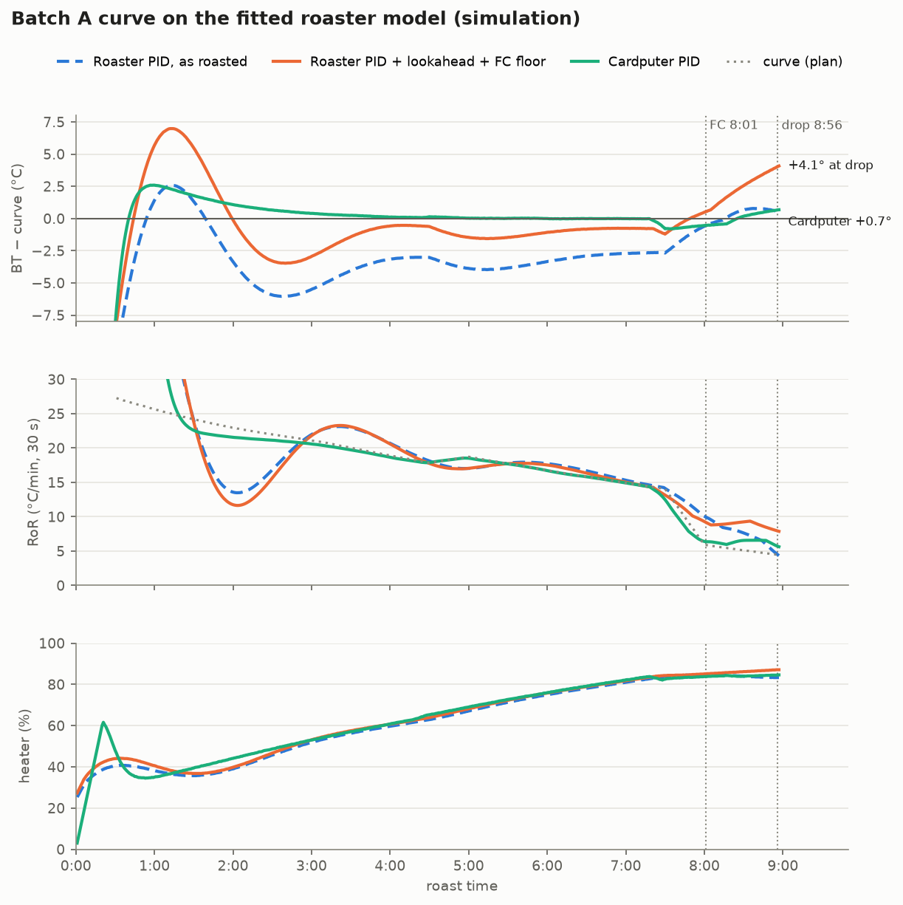

A 锅在拟合模型上的对比（`tools/pid/run.sh`；RMS 是 1:00 到排豆期间 豆温 − 曲线 的均方根；排豆在 8:56，那时曲线是 206.4 °C）：

| | RMS | 排豆豆温 | 一爆后最低 RoR |
|---|---|---|---|
| 烘豆机 PID，当时的设置（无提前量、无兜底） | 3.4 °C | 207.0 | 4.3 |
| 烘豆机 PID，提前 8 秒 + 一爆兜底 +1 °C | 2.5 °C | 210.6 | 7.9 |
| **Cardputer PID** | **0.74 °C** | **206.5** | 4.4 |
| 烘豆机 PID，提前量 + 兜底，模型偏 15%、死区 7 秒 | 3.5 °C | 210.4 | 5.7 |
| Cardputer PID，模型偏 15%、死区 7 秒 | 1.5 °C | 207.5 | 4.3 |

烘豆机自带的 PID（寄存器 20–23：周期 1000 ms，P 6、I 1、D 8）拟合出来是 火力 = 0.50 e + 0.036 ∫e dt + 12%（三锅 R² 都在 0.995–0.998）。积分时间约 14 秒，而豆子的时间常数约 57 秒，所以它反应慢、之后又会冲过头。

**烘豆机 PID**（关掉 *PID on Cardputer*）：Roast 每秒写一次烘豆机的目标温度（SV，寄存器 9），火力由烘豆机自己的 PID 决定。SV 由两条规则决定：

- **SV 提前量**（0–20 秒，默认 8）：SV = curve(t + 提前量)。PID 有滞后（加热丝 → 热风 → 豆子），所以瞄准曲线几秒后的位置。Artisan 跟随参考曲线也是这样做的。超过曲线终点就保持最后一个值。用 Cardputer PID 时，提前量只用在前馈上。
- **一爆兜底**（默认开）：一爆窗口内，SV 不低于"豆温 + 兜底高于豆温"（默认 1 °C），这样 PID 不会为了贴回曲线而减火。兜底不超过"曲线 + 兜底上限"。有积分项时，这样会一直把豆温往上推：模拟器里排豆时比曲线高约 4 °C，上限 +8 °C 时最多高 8.6 °C。立即排豆和安全自动排豆不变。兜底第一次抬高 SV 时会记一条操作日志，烘焙页的"target"那一行改成显示"FC floor SV …"（用 Cardputer PID 时显示"FC hold: heat on plan"）。

日志的 `target` 列记录写入的 SV（用 Cardputer PID 时是它的目标，也就是"现在"的曲线）。**P**（手动火力）改成保持最近 30 秒的平均火力，而不是某一个瞬时读数。

### 最低风力保护
烘豆机自己的最低风力寄存器是 50%。短按 ↓ 会停在 **50%**，再往下会停在 **40%**。要降到某道门槛以下，先停在门槛上，再长按 ↓ 至少 0.6 秒，会降到门槛下一档；之后短按又能继续往下，直到下一道门槛。待机时调开风预设、以及 0.1% 微调，都遵守同样的规则。

### 规则、提醒和自动动作
**O** 打开规则页，按用途分组。按 Enter 修改：← → 微调，也可以直接输入数字，下方显示允许的范围；窗口和升温这类范围规则，先改下限再改上限。设置保存在 NVS 中。

| 设置 | 默认值 |
|---|---|
| 一爆后的发展时间窗口 | 75–85 秒 |
| 一爆后的升温 | +5 ～ +6 °C |
| 立即排豆温度 | 206 °C |
| 安全自动排豆温度 | 225 °C |
| 曲线结束后多久自动排豆 | 120 秒 |
| RoR 过低提醒 | 低于 5 |
| 一爆后火力下降提醒 | 5% |
| 开风风力 | 53% |
| 冷机温度 | 40 °C |
| 曲线温度补偿 | 0 °C |
| SV 提前量（SV lookahead） | 8 秒 |
| 一爆兜底（FC floor） | 开 |
| 兜底高于豆温（floor above BT） | 1 °C |
| 兜底上限（floor cap，高于曲线） | 8 °C |
| 麦克风增益（mic gain） | 18 dB |

底栏颜色的含义：进入排豆窗口时变绿；超过发展上限或到达立即排豆温度时变红；以下情况变黄：火力在 95% 以上持续 20 秒、一爆后火力下降、在窗口之前就达到升温要求、一爆 30 秒后 RoR 过低。

蓝牙断开时，读数变灰，底栏变红。烘豆机会按最后的目标温度继续加热，而烘焙中不会有声音提醒，要留意屏幕；Roast 会自动重连。

Roast 只在两种情况下自动排豆，作为安全兜底：豆温达到安全温度，或曲线结束后超过"曲线结束后多久自动排豆"设定的时间。如果想和手机 App 一样在曲线结束时就排豆，把这个值设为 0。

### 曲线编辑器
编辑器用表格列出和手机 App 相同的 8 个节点（初始、脱水、一爆始、一爆末、二爆始、二爆末、排豆、总用时），表格右侧显示曲线，并高亮当前节点。

- **空格** 启用或关闭节点。排豆和总用时始终启用。第一次启用的节点，时间放在前后两个已启用节点的正中间。
- **Enter**（或直接输入数字）编辑这一行：分钟，Enter，秒，Enter，温度，Enter。Tab 可以跳过时间直接改温度。时间必须落在前后两个已启用节点之间，排豆不能晚于总用时，总用时最长 30:00。
- 灰色的温度表示没改过：这个节点只把曲线钉在原位，不改变曲线形状，和手机 App 一样。按 Backspace 可以把温度恢复为预设值。
- **S** 保存到 SD 卡的 `roast/curves/`，**N** 重命名，**B** 设置投豆量，**Tab** 预览。

新曲线以手机 App 的深烘预设为起点，曲线形状的计算方式和手机 App 一致（见[与手机 App 的一致性](#与手机-app-的一致性)）。

## SD 卡
SD 卡需要 FAT32 格式。没有 SD 卡时，记录只保存在内存里，关闭总结页后就没有了。

| 路径 | 内容 |
|---|---|
| `roast/curves/*.json` | 曲线（格式见下）。 |
| `roast/curves/*.alog` | Artisan 或 myERoast 导出的曲线，只读；以 `temp2` 作为目标温度。 |
| `roast/logs/<编号>.csv` | 每秒一行：`t,bt,target,heat,fan,ror,pid,machine_t,heat_cmd,ff,p,i,d`。`pid`：0 手动，1 烘豆机 PID，2 Cardputer PID。最后五列只在 Cardputer PID 时有值：写出的火力，以及其中前馈、P、I、D 各占多少（%）。打点和操作记录在以 `#` 开头的行里。 |
| `roast/logs/<编号>.json` | 本锅总结。 |
| `roast/logs/<编号>.alog` | 可导入 Artisan。 |
| `roast/logs/<编号>.wav` | 本锅录音（32 kHz、16 位、单声道），采样数据从第 512 字节开始。 |

曲线 JSON：
```json
{
  "name": "Gotiti 200g Light V3",
  "note": "Drop 75-85 s after FC at +5-6 C, max 206 C",
  "batch_g": 200,
  "total_s": 570,
  "points": [
    {"t": 0,   "c": 50,  "tag": "CHARGE"},
    {"t": 285, "c": 150, "tag": "DRY"},
    {"t": 470, "c": 199, "tag": "FCs"},
    {"t": 570, "c": 209, "tag": "DROP"}
  ]
}
```
- `t` 单位是秒，`c` 单位是 °C。
- 省略 `c` 表示这个时间点沿用预设曲线的温度。
- 标签有 `CHARGE`、`DRY`、`FCs`、`FCe`、`SCs`、`SCe` 和 `DROP`。

录了音的烘焙，总结 JSON 里会有 `audio` 对象：
```json
"audio": {
  "file": "R0012.wav", "format": "wav pcm 16-bit mono", "sample_rate": 32000, "mic_gain_db": 18,
  "start_ms_after_charge": 4, "duration_s": 812.37, "peak_dbfs": -7.9, "clipped_samples": 0, "buffer_ms": 896,
  "i2s_slot": "right",
  "events_ms": {"charge": 0, "dry": 284996, "fc_start": 471512, "fc_end": 529870, "drop": 569004},
  "silence": []
}
```
`events_ms` 是各打点在 WAV 文件里的位置（毫秒）。`silence` 列出因 SD 卡卡住超过缓冲（`buffer_ms`）而补进去的静音（`{"at_ms", "ms"}`），正常情况下是空的。

## 协议说明（E-Meter621 BLE）
- **GATT：** 服务 `FFF0`。
  - 指令写到 `FFF1`（write-without-response + notify）。
  - 回复以通知的形式从 `FFF2` 返回（notify + read）；直接读取 `FFF2` 得到的是设备名。
  - 手机 App 代码里写的是 `FFE0`/`FFE1`，但这个模块实际提供的是 `FFF0`。
- **帧格式：** Modbus RTU，从站地址 1。读寄存器用 FC03，写寄存器用 FC06，设备回显即表示写入成功。
- **寄存器**（除特别说明外，数值都放大了 10 倍）：

  | 寄存器 | 含义 |
  |---|---|
  | 2 | 烘焙计时（秒） |
  | 4 | 豆温 |
  | 9 | PID 目标温度 |
  | 11 | 火力 % |
  | 12 | 风力 % |
  | 13 | `1` = 启动 |
  | 14 | `2` = 排豆，`1` = 停机 |
  | 15 | PID 开/关 |
  | 16 | 风机输出 |
  | 20 | PID 周期 |
  | 21–23 | P/I/D |
  | 28 | 最低风力 |
  | 29 | 最大火力 |

- **配对：** 这个模块不响应 SMP 配对。ESP-IDF 示例配置里设了 `CONFIG_BT_NIMBLE_SM_LVL=2`，NimBLE 会因此悄悄丢掉未加密连接上的通知。Roast 在连接期间把 `ble_hs_cfg.sm_sec_lvl` 设为 0，断开后恢复。
- **节奏：** 每秒约读 2.8 帧。指令最多重试 3 次，每次等待回显 2 秒；连续 15 秒没有数据判定为断线。

## 与手机 App 的一致性
验证方法：在 Node 中运行手机 App 的原版 JavaScript，与本固件的 C++ 实现逐项对比。

| 项目 | 结果 |
|---|---|
| 曲线生成 | 预设曲线按总用时截断或延长；初始温度用余弦平滑过渡；每个节点的温度修改，在相邻节点之间线性拉伸曲线。与手机 App 逐秒对比，误差在 0.01 °C 以内。 |
| RoR | \|当前豆温 − 29 个读数前的豆温\| ÷ 0.5，35 秒后才显示。 |
| 曲线时间基准 | 使用机器计时（寄存器 2）；与本地计时相差超过 5 秒时改用本地计时。 |
| 指令 | 启动、无曲线投豆、风力 ±1、排豆、停机、每秒写目标温度，写入的寄存器和值完全相同。 |

有意与手机 App 不同的地方：
- 有曲线时投豆，会先写入起点目标温度（寄存器 9），再启动 PID。
- 关闭 PID 时同时写入当前火力（寄存器 11），避免火力跳变。
- 烘焙中按 P 可以重新打开 PID。
- 火力调节只在手动模式下发送。
- 曲线走完不会强制排豆（见"曲线结束后多久自动排豆"）。

未实现：
- 手机 App 的自动风力（按温度切换风力）；
- 运行参数写入（寄存器 20–29）。

## 编译
使用 ESP-IDF **v5.4.2**：
```sh
python3 fetch_repos.py        # 把 M5GFX、M5Unified、mooncake 等依赖克隆到 components/
idf.py build                  # 生成 build/cardputer-roast.bin（Launcher 安装用的 app 镜像）
```
CI 在 `espressif/idf:v5.4.2` 容器里执行同样的步骤。推送 `v*` 标签会自动发布 Release，并附上 `.bin`。

### 桌面预览
不用设备也能检查界面。`tools/preview/` 把 Roast 的真实代码（页面、按键、曲线、记录、模拟器）编译成桌面程序，用替身 HAL 和假时钟跑一锅预设的模拟烘焙，把每个页面导出为 240×135 的 PNG：
```sh
export IDF_PATH=~/esp/esp-idf-v5.4.2      # 用到其中的 cJSON
tools/preview/build.sh && build_preview/preview build_preview/shots
python3 tools/preview/sheet.py build_preview/shots sheet.png   # 可选：拼成总览图（需要 Pillow）
```
CI 会把同样的截图作为 `ui-preview` 附件上传。

### 字体
界面使用 Space Grotesk 字体（SIL OFL 1.1，见 `tools/fonts/OFL.txt`），以抗锯齿 VLW 格式编译进固件。运行 `python3 tools/fonts/make_vlw.py` 可重新生成 `main/apps/app_roast/fonts/roast_fonts_data.h`（需要 Pillow）。

## USB 串口调试接口
app 在 USB 串口上监听调试命令，可以用 `tools/rdbg.py` 操作：
```sh
python3 tools/rdbg.py quiet key s wait 2 shot prep.png
python3 tools/rdbg.py raw regs 2
python3 tools/rdbg.py raw 'ls /sdcard/roast/logs' 2
```
支持的操作：
- 模拟按键、长按和输入文字；
- 整屏（240×135）截图；
- `quiet`、`ping`、`regs`；
- SD 卡列目录（`ls`）、读文件（`cat`）、删除 `/sdcard/roast/` 下的文件（`rm`）、查看卡信息（`sdinfo`）；
- `rec`（录音状态和电平）、`b64 <文件> <偏移> <长度>`（以 base64 读取文件的一段）；
- `net`（Wi-Fi 和 Dropbox 配置状态、剩余内存；不含账号信息）。

`tools/pull_audio.py <编号> [秒数]` 通过 USB 拉取录音开头的一段，逐秒打印峰值、RMS 电平和补静音的比例，并标出 JSON 里的打点。速度大约每 1–2 秒拉 1 秒音频，整锅录音建议直接拔 SD 卡读。

## 许可证
[MIT](LICENSE)。本项目基于 M5Stack 的 [M5Cardputer-UserDemo](https://github.com/m5stack/M5Cardputer-UserDemo)（`CardputerADV` 分支，MIT 许可证），其版权声明保留在 `LICENSE` 中。第三方部分遵循各自的许可证：
- Space Grotesk 字体：SIL Open Font License 1.1（`tools/fonts/OFL.txt`）；
- 由 `fetch_repos.py` 拉取的 M5GFX、M5Unified、mooncake、mooncake_log、smooth_ui_toolkit：见各自的仓库。

本仓库的其余内容，包括 `main/apps/app_roast/preset_dark.h` 中的深烘预设数据，均以 MIT 许可证发布。

app 打包面向 [bmorcelli/Launcher](https://github.com/bmorcelli/Launcher)。
